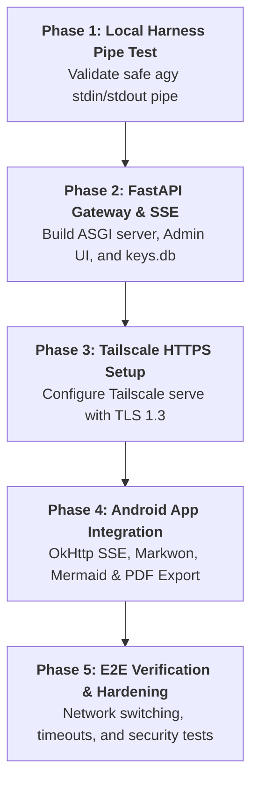

# Product Management Skill (THLawDeka-mobile)

Provides structured workflows, roadmap decomposition, and acceptance rubrics for technical Product Managers overseeing the **THLawDeka-mobile** implementation.

---

## 1. Grounded Roadmap & Milestone Phases
All backlog items and tasks must strictly align with the 5 phases defined in `techdocs/system_spec_and_implementation_plan.md`:

---

## 2. Core Epics & Acceptance Criteria Rubric

### Epic 1: Local Pipe & Safety Harness (Phase 1)
- **US-001**: Run `agy` via Python `stdin` pipe without exposing prompt in OS process table.
  - *Given* a query string with case facts, *When* piped to `agy.exe -p - --sandbox --dangerously-skip-permissions`, *Then* stdout streams valid NDJSON and process list contains no prompt text.

### Epic 2: FastAPI Gateway & Access Control (Phase 2)
- **US-002**: Stream SSE responses over HTTP with Bearer Token authentication.
  - *Given* an active key in `keys.db`, *When* client posts to `/api/v1/chat/stream`, *Then* SSE events (`status`, `token`, `done`) stream with `X-Accel-Buffering: no`.
- **US-003**: Web Admin UI for key issuance and revocation.
  - *Given* master `ADMIN_SECRET`, *When* accessing `/admin`, *Then* admin can generate `thlaw_live_<hex32>` keys and revoke active keys immediately.

### Epic 3: Tailscale HTTPS Mesh (Phase 3)
- **US-004**: Secure home server gateway behind Tailnet HTTPS proxy.
  - *Given* Tailscale daemon running on host, *When* running `tailscale serve --bg https / http://127.0.0.1:8000`, *Then* traffic on port 443 routes to port 8000 with valid TLS cert.

### Epic 4: Android Mobile Client (Phase 4)
- **US-005**: Android SDK 36 Baseline, Debug-Key Release Signing & Minimal APK Size.
  - *Given* Android Gradle project, *When* configuring `app/build.gradle.kts`, *Then* `compileSdk = 36`, `targetSdk = 36`, `minSdk = 26`, `buildTypes.release` is signed with `signingConfigs.getByName("debug")`, and R8 minification/resource shrinking/language filtering (`th`, `en`) are enabled to produce the smallest possible APK size.
- **US-006**: Real-time legal consultation chat with token streaming.
  - *Given* Android device on Tailnet, *When* user asks a legal question, *Then* text streams via OkHttp SSE with Markdown rendering and GFM comparison tables.
- **US-007**: Sandboxed Mermaid diagram rendering.
  - *Given* legal flowchart markdown, *When* rendered in WebView, *Then* Mermaid diagram displays zoomable SVG without network access.
- **US-008**: Encrypted Settings & Health Check.
  - *Given* gateway URL and auth key, *When* user clicks Test Connection, *Then* app verifies health before saving to `EncryptedSharedPreferences`.
- **US-009**: Native A4 PDF Export.
  - *Given* consultation report, *When* user taps Export PDF, *Then* Android PrintManager renders official A4 document with correct page breaks.
- **US-010**: Multi-Chat Session Management (Continue, New & Delete).
  - *Given* existing chat records in local SQLite, *When* user chooses a previous chat, *Then* conversation history is restored and new prompts continue with `conversation_id`.
  - *Given* active session, *When* user clicks '+ แชตใหม่', *Then* screen resets and starts a fresh conversation.
  - *Given* any chat session, *When* user deletes it and confirms in dialog, *Then* session and its messages are permanently erased from SQLite.

### Epic 5: Resiliency & Security Hardening (Phase 5)
- **US-011**: 60-Second Subprocess Timeout & Zombie Reaping.
- **US-012**: Anti-Injection & Null-Byte Scrubbing.
- **US-013**: Gateway Artifact Handshake & Mobile File Download.
  - *Given* user requests saving legal analysis to a file, *When* Core Agent processes the request, *Then* it strictly enforces Server-Side Zero-Disk-Write Policy, streams the full Markdown answer directly through Gzip compression, and guides the user to export as `.md`, `.pdf`, or `.txt` directly on the Android app.
- **US-014**: Strict .md File Whitelist & Non-MD Rejection.
  - *Given* user asks to save files on the server or in unsafe formats, *When* Core Agent processes the request, *Then* it responds with the complete legal analysis in pure Markdown without server file creation, and informs user to use local on-device export.
- **US-015**: Stop Generating Button & Server Semaphore Release.
  - *Given* active SSE streaming, *When* user taps Stop, *Then* Android cancels EventSource, SQLite saves status as `interrupted`, and FastAPI kills subprocess to immediately free up CPU and Semaphore(3).
- **US-016**: FileProvider Native Sharing for Legal Documents (.md / .pdf).
  - *Given* locally exported .md, .pdf, or .txt file, *When* user taps Share, *Then* app launches Android Share Sheet via FileProvider to send files to LINE, Email, or Google Drive.
- **US-017**: Official A4 Court Layout & Sarabun Typography for PDF Export.
  - *Given* consultation report, *When* exported to PDF, *Then* WebView PrintManager applies A4 court margins (20mm/15mm) and Sarabun font with page-break avoidance for legal tables.
- **US-018**: Network Disconnect State Persistence & Retry Flow.
  - *Given* network drop during streaming, *When* connection fails, *Then* app preserves partial text with `interrupted` status and offers a Retry action continuing with `conversation_id`.
