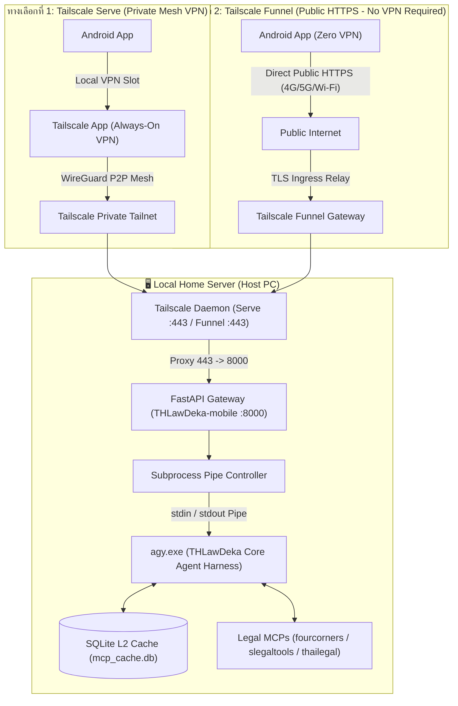

# Software Architecture Skill (THLawDeka-mobile)

Provides architectural guidelines, security topologies, and structural decision-making frameworks for Software Architects designing the **THLawDeka-mobile** ecosystem.

---

## 📚 Scanned Skills & Playbooks Reference
When designing network boundaries, reverse proxies, and TLS configurations, refer to:
- [Network Engineering Playbook](references/network-engineering.md) (WireGuard VPN, Zero-Trust networking, Reverse proxies, SSL/TLS Let's Encrypt)

---

## 1. System Topology & Architecture Standards

### 1.1 Network & Security Topology


### 1.2 The 5-Layer Threat Model
Every architecture proposal must be validated against the 5 security layers:
1. **Confidentiality Layer**: Client facts sent via `stdin` (`-p -`), never in process command arguments.
2. **Command Injection Layer**: Subprocess executed as argument arrays (`shell=False`), Null bytes (`\x00`) stripped at gateway.
3. **Prompt Injection Layer**: Enforce `--sandbox` isolation and IRAC legal framework constraints in `AGENTS.md`.
4. **Denial of Service (DoS) Layer**: Concurrency capped with `Semaphore(3)`, 32KB payload ceiling, Zombie Process Reaper killing hung subprocesses after 60s.
5. **Transport Layer**: Tailscale WireGuard mesh + Let's Encrypt HTTPS (TLS 1.3). Zero public open ports.

---

## 2. Monorepo Structural Contract
The project follows a decoupled monorepo architecture:
```text
THLawDeka-mobile/
├── THLawDeka/                     # Core Agent Harness Workspace
│   ├── AGENTS.md                  # Legal rules & IRAC framework
│   ├── .agents/skills/            # Legal MCP skills
│   └── cache/mcp_cache.db         # Supreme Court precedent cache
│
├── backend/                       # Backend Gateway (FastAPI ASGI)
│   ├── main.py                    # Gateway Server, Admin Routes & agy Controller
│   ├── auth_db.py                 # SQLite keys.db manager
│   ├── manage_keys.py             # CLI key management tool
│   ├── templates/admin.html       # Web Admin Dashboard
│   └── requirements.txt           # Python dependencies
│
├── android/                       # Android Application Project
│   ├── app/build.gradle.kts       # Android SDK 36 (targetSdk 36, debug-key sign, minimal APK size R8/shrinking), OkHttp, Markwon
│   └── app/src/main/              # Kotlin source (ChatDatabaseHelper SQLite, SSE, Markwon, Mermaid) & assets
│
└── techdocs/                      # System specifications and runbooks
```

---

## 3. Protocol Contracts
- **SSE Stream Contract (`POST /api/v1/chat/stream`)**:
  - Request Header: `Accept-Encoding: gzip`
  - Request Body: `{"query": "string", "conversation_id": "string | null"}` (Supports continuing previous chat)
  - Response Header: `Content-Encoding: gzip` (SSE compressed stream reducing bandwidth by ~70-85%)
  - `status`: Progress updates (`{"text": "..."}`)
  - `token`: Incremental answer text (`{"delta": "..."}`)
  - `done`: Finalization (`{"status": "completed", "conversation_id": "..."}`)
  - `error`: Error envelope (`{"code": int, "message": "..."}`)
- **Server-Side Zero-Disk-Write Contract**:
  - Strictly enforces Read-Only operation: no client requests can create, write, or delete files on server disk.
  - 100% On-Device Local Export on Android Client: export to `.md`, `.pdf` (via A4 Sarabun `PrintManager`), and `.txt` locally.
- **Health Check Contract (`/api/v1/health`)**:
  - Returns `{"status": "healthy", "service": "thlawdeka-gateway", "version": "1.0.0"}` with Bearer auth.
