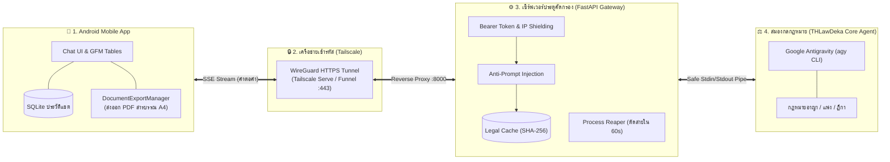

# 🚀 THLawDeka-mobile: คู่มือเริ่มต้นฉบับจับมือทำสำหรับ Linux (Newbie-Proof Step-by-Step Guide for Linux)
## สำหรับผู้ใช้งาน Ubuntu, Debian, Fedora, Arch Linux หรือ WSL2 ตั้งแต่ศูนย์จนใช้งานได้จริง 100%

> 🪟 **สำหรับผู้ใช้งานระบบปฏิบัติการ Windows 11:**
> โปรดอ่านคู่มือฉบับเฉพาะของ Windows ได้ที่: [Quick_start_Windows.md](Quick_start_Windows.md)

คู่มือนี้เขียนขึ้นสำหรับผู้ใช้งานระบบปฏิบัติการ Linux ทุกระดับ ครอบคลุม **Ubuntu 22.04/24.04 LTS, Debian, Fedora, Arch Linux รวมถึง WSL2 (Windows Subsystem for Linux)** โดยอธิบายแบบทีละขั้นตอน (Step-by-Step) ตั้งแต่การแตกไฟล์ ติดตั้งโปรแกรม จัดการสิทธิ์ USB (udev rules) สั่ง AI Agent พัฒนา ไปจนถึงรันแอปบนมือถือหรือ Emulator จริง พร้อมหัวข้อแก้ปัญหาที่พบบ่อย (Troubleshooting) อย่างครบถ้วนครับ

---

### 📦 สำหรับ "ผู้ส่งไฟล์" (ทำก่อน Zip ส่งให้เพื่อน):
ก่อนกดบีบอัดเป็นไฟล์ `THLawDeka-mobile.zip` ให้ตรวจเช็ก 2 ข้อนี้ เพื่อให้ไฟล์มีขนาดเล็กกะทัดรัด (เพียง 1-2 MB แทนที่จะเป็น 200+ MB):
1. ลบโฟลเดอร์ `backend/.venv` (หากเคยสร้างไว้) ทิ้งก่อน
2. ลบโฟลเดอร์แคช `__pycache__` ต่างๆ ทิ้งก่อน
*(เพื่อนของคุณจะสร้างสภาพแวดล้อมใหม่ที่สะอาดบนเครื่องของเขาเองตามคู่มือนี้ในเวลาเพียงไม่กี่วินาทีครับ)*

---

## 🧭 แผนผังภาพรวม 7 ขั้นตอนบน Linux (ทำตามลำดับนี้ได้เลย):
```text
[ขั้นตอนที่ 1] แตกไฟล์ Zip ในโฟลเดอร์ Home (~/THLawDeka-mobile)
      ↓
[ขั้นตอนที่ 2] ติดตั้งเครื่องมือจำเป็นบน Linux (curl, uv, Python 3.12, Android Studio, Tailscale)
      ↓
[ขั้นตอนที่ 3] ทดสอบเครื่องมือ AI (agy CLI) ในโฟลเดอร์ THLawDeka
      ↓
[ขั้นตอนที่ 4] สร้างสภาพแวดล้อม (.venv) และลงแพ็กเกจในโฟลเดอร์ backend
      ↓
[ขั้นตอนที่ 5] เปิดโปรเจกต์ใน Antigravity Desktop
      ↓
[ขั้นตอนที่ 6] คัดลอกคำสั่ง Master Prompt สั่ง AI เริ่มพัฒนา Phase 1 ถึง Phase 5
      ↓
[ขั้นตอนที่ 7] รันเซิร์ฟเวอร์, เปิดอุโมงค์ Tailscale HTTPS, และเปิดแอปเพื่อใช้งานจริง!
```

---

## 🧠 สถาปัตยกรรมและหลักการทำงานของระบบ (System Architecture & How It Works)

ระบบ **THLawDeka-mobile** คือแพลตฟอร์มผู้ช่วยทนายความและที่ปรึกษากฎหมายไทยอัจฉริยะแบบพกพา ซึ่งออกแบบภายใต้แนวคิด **"ความปลอดภัยสูงสุด ข้อมูลส่วนตัวไม่รั่วไหล และตอบคำถามได้แบบเรียลไทม์"** โดยแบ่งการทำงานออกเป็น **4 ส่วนหลัก** ประสานงานกันอย่างราบรื่น:



### 🔍 หน้าที่ของแต่ละส่วนประกอบ:

1. **📱 ส่วนที่ 1: แอปพลิเคชันบนมือถือ (Android Client - Kotlin Native)**
   * **หน้าจอสนทนา (Real-time SSE Chat UI):** รับและแสดงผลข้อความวิเคราะห์กฎหมายแบบสตรีมมิ่งคำต่อคำ (Streaming Tokens) นุ่มนวล เสมือนมีผู้ช่วยพิมพ์ตอบสด ๆ
   * **การแสดงผลทางกฎหมาย:** แสดงผลตารางเปรียบเทียบมาตรากฎหมาย (GFM Tables) และแผนผังขั้นตอนคดีความ (Mermaid Chart) ผ่านระบบตัดคำภาษาไทยความคมชัดสูง (`BREAK_STRATEGY_HIGH_QUALITY`)
   * **บันทึกข้อมูลแบบออฟไลน์ 100%:** จัดการห้องสนทนา (แชตต่อของเดิม / สร้างแชตใหม่ / ลบแชต) เก็บลงฐานข้อมูล SQLite ในเครื่องมือถือ ไม่มีการส่งประวัติคดีความไปเก็บที่เซิร์ฟเวอร์
   * **ส่งออกเอกสารบนเครื่อง (Zero-Disk-Write Server):** ฟังก์ชัน `DocumentExportManager` แปลงบทสนทนาเป็นเอกสาร **PDF ฟอนต์สารบรรณขนาด A4 มาตรฐานราชการ**, ไฟล์ Markdown (`.md`), หรือข้อความ (`.txt`) และสั่งพิมพ์หรือแชร์ทาง LINE ได้ทันทีจากมือถือ โดยไม่ต้องขอให้เซิร์ฟเวอร์สร้างไฟล์
   * **ค้นหาคดีความออฟไลน์และกู้คืนสตรีม:** รองรับ **SQLite FTS5 Full-Text Search** ค้นหาคำสำคัญในฎีกาเก่าได้ทันทีแม้อยู่ในห้องพิจารณาคดีที่ไม่มีสัญญาณเน็ต พร้อมระบบ **Partial Stream Recovery** บันทึกคำตอบบางส่วนและถามต่อได้ทันทีหากสัญญาณหลุด

2. **🔒 ส่วนที่ 2: เครือข่ายอุโมงค์เข้ารหัส (Tailscale HTTPS Tunnel)**
   * เชื่อมต่อระหว่างโทรศัพท์มือถือกับเครื่องคอมพิวเตอร์ผ่านเครือข่ายส่วนตัวเสมือน (WireGuard Mesh) หรือต่อผ่านอินเทอร์เน็ตสาธารณะด้วย Tailscale Funnel พร้อมใบรับรองความปลอดภัย HTTPS
   * สามารถใช้งานแอปจากนอกบ้านผ่านสัญญาณเน็ต 4G/5G ได้ทันที โดย **ไม่ต้องตั้งค่าเร้าเตอร์หรือเปิดพอร์ตบ้าน (No Port Forwarding)**

3. **⚙️ ส่วนที่ 3: เซิร์ฟเวอร์ประตูคัดกรองความปลอดภัย (FastAPI Gateway & Pipe Controller)**
   * **ตรวจสอบสิทธิ์ฉับไว ($O(1)$ Token Cache):** ตรวจสอบ API Key ของมือถือในหน่วยความจำ RAM อย่างรวดเร็ว ป้องกันการยิงสแปม
   * **ระบบแคชคำถามกฎหมายยอดฮิต (Fast-Path Legal Cache):** หากมีคำถามเดิมที่เคยตอบไว้แล้ว ระบบจะส่งคำตอบกลับทันทีใน 0.05 วินาที โดยไม่ต้องปลุก AI
   * **เกราะป้องกันการเจาะระบบ (Gateway Pre-Filter):** ตรวจจับและสกัดกั้นคำสั่งแฮกหรือ Prompt Injection ก่อนส่งไปยังตัวประมวลผล
   * **ระบบบีบอัดข้อมูลอัจฉริยะ (Selective Gzip):** บีบอัดข้อมูลหน้าเว็บ Admin ประหยัดแบนด์วิดท์ 70-85% แต่ปล่อยเส้นทางสตรีมมิ่งสดให้วิ่งตรงโดยไม่ติดค้างบัฟเฟอร์
   * **Zombie Process Reaper:** หากมือถือปิดจอหรือสัญญาณเน็ตหลุด เซิร์ฟเวอร์จะสั่งตัดโปรเซส AI ทันที ไม่ปล่อยให้ทำงานค้างกินทรัพยากรคอมพิวเตอร์
   * **Zero-PII Audit Logging:** บันทึกเฉพาะเมทริกซ์เชิงตัวเลข (เวลา, ขนาดไบต์, รหัสสถานะ) **ห้ามบันทึกข้อเท็จจริงคดีหรือคำถาม/คำตอบลง Disk Log เด็ดขาด** เพื่อจรรยาบรรณวิชาชีพและ PDPA
   * **Per-Key Rate Limiting:** จำกัดความถี่ไม่เกิน 10 คำขอ/นาทีต่อกุญแจ ป้องกันการสแปมคิว AI (Semaphore)
   * **Automated SQLite Backup:** สำรองข้อมูล `keys.db` อัตโนมัติแบบ Online Backup ย้อนหลัง 7 ชุด
   * **Long-Context Budgeting:** ส่งสัญญาณเตือนเมื่อบริบทคดีสะสมเกิน 64KB เพื่อแนะนำให้ย่อสรุปด้วย `/compact` หรือเปิดห้องแชตใหม่

4. **⚖️ ส่วนที่ 4: สมองกลกฎหมายไทย (THLawDeka Core Agent - Google Antigravity)**
   * ทำงานผ่านคำสั่ง `agy` CLI ในโหมดความปลอดภัยสูง (`--sandbox`)
   * มีทักษะและความรู้ความเชี่ยวชาญเฉพาะทาง (Specialized Skills) เช่น ประมวลกฎหมายอาญา ประมวลกฎหมายแพ่งและพาณิชย์ พระราชบัญญัติเฉพาะทาง และคลังแนวคำพิพากษาศาลฎีกา
   * รับคำถามกฎหมายผ่านท่อส่งข้อมูลมาตรฐาน (`stdin`) และวิเคราะห์ส่งคืนผลลัพธ์ผ่านท่อข้อมูล (`stdout`) โดยไม่มีการเปิดช่องโหว่รันคำสั่งเชลล์ภายนอก (Zero-Shell Execution)

---

### ⏱️ วงจรการทำงานตั้งแต่พิมพ์ถามจนได้คำตอบ (5 ขั้นตอน):
```text
[1] ผู้ใช้พิมพ์คำถามบนมือถือ (เช่น ปรึกษาเรื่องคดีเช่าบ้าน หรือ ม.341)
     ↓
[2] มือถือส่งคำถามผ่าน HTTPS พร้อม API Key เข้าสู่ Gateway
     ↓
[3] Gateway ตรวจสอบความปลอดภัย ตรวจสิทธิ์ และเช็กแคชคำตอบ
     ↓
[4] Gateway ส่งคำถามเข้าสมอง AI (agy) ผ่านท่อ Safe Stdin แบบปลอดภัย
     ↓
[5] สมอง AI สตรีมคำตอบส่งคืนถึงหน้าจอมือถือแบบ Real-time และกดบันทึกเป็น PDF ทันที
```

---

## 🗂️ ขั้นตอนที่ 1: การแตกไฟล์ Zip บน Linux

1. เมื่อได้รับไฟล์ `THLawDeka-mobile.zip` ให้บันทึกไว้ใน Home Directory ของคุณ (`~/Downloads` หรือ `~/`)
2. เปิดโปรแกรม **Terminal** (`Ctrl + Alt + T` บน Ubuntu/Debian)
3. รันคำสั่งแตกไฟล์ไปยังโฟลเดอร์ `~/THLawDeka-mobile`:
   ```bash
   mkdir -p ~/THLawDeka-mobile
   unzip ~/Downloads/THLawDeka-mobile.zip -d ~/THLawDeka-mobile
   ```
   *(หรือคลิกขวาที่ไฟล์ zip ในโปรแกรม Files/Nautilus แล้วเลือก **Extract Here**)*
4. ⚠️ **จุดตรวจเช็กสำคัญ (ป้องกันโฟลเดอร์ซ้อน):**
   - รันคำสั่งตรวจสอบ:
     ```bash
     cd ~/THLawDeka-mobile && ls -la
     ```
   - **จะต้องเห็นโฟลเดอร์ชื่อ `backend`, `THLawDeka`, `techdocs` และไฟล์ `Quick_start_Linux.md` ทันที**
   - *หาก `ls` แล้วเจอโฟลเดอร์ชื่อ `THLawDeka-mobile` ซ้อนอยู่อีกชั้นหนึ่ง ให้ย้ายเข้าไปทำงานในโฟลเดอร์ชั้นในนั้นด้วยคำสั่ง `cd THLawDeka-mobile` ครับ*

---

## 🛠️ ขั้นตอนที่ 2: ติดตั้งเครื่องมือจำเป็นบน Linux (ทำครั้งเดียว ใช้ได้ตลอดไป)

### 🔹 2.1 ติดตั้ง `curl`, `uv` และ `Python 3.12`
1. ใน Terminal ให้ติดตั้ง `curl` ก่อน (หากยังไม่มี):
   * **Ubuntu / Debian:** `sudo apt update && sudo apt install -y curl unzip build-essential`
   * **Fedora:** `sudo dnf install -y curl unzip gcc`
   * **Arch Linux:** `sudo pacman -S --needed curl unzip base-devel`
2. ติดตั้งเครื่องมือจัดการ Python ความเร็วสูง **`uv`**:
   ```bash
   curl -LsSf https://astral.sh/uv/install.sh | sh
   ```
3. โหลดค่า PATH ให้ระบบรู้จักคำสั่ง `uv`:
   ```bash
   source ~/.bashrc  # หากใช้ zsh ให้รัน source ~/.zshrc
   ```
4. ติดตั้ง **Python 3.12** แบบแยกส่วน (Standalone) ผ่าน `uv`:
   ```bash
   uv python install 3.12
   ```
   *(รอประมาณ 5-10 วินาที ระบบจะดาวน์โหลดและติดตั้ง Python 3.12 ให้เสร็จสมบูรณ์ โดยไม่กระทบกับ Python ประจำเครื่องของ Linux)*

---

### 🔹 2.2 ติดตั้ง Google Antigravity Desktop (โปรแกรมควบคุม AI Agent)
1. ดาวน์โหลดโปรแกรม **Antigravity Desktop** สำหรับ Linux (.deb / .tar.gz / AppImage) จากเว็บไซต์ทางการ: [https://antigravity.google](https://antigravity.google)
2. ติดตั้งตามประเภทไฟล์:
   * **กรณี .deb (Ubuntu/Debian):**
     ```bash
     sudo dpkg -i antigravity_*.deb || sudo apt --fix-broken install -y
     ```
   * **กรณี AppImage:** คลิกขวา -> Properties -> Permissions -> ติ๊กถูกที่ "Allow executing file as program" แล้วดับเบิลคลิกเปิดใช้งาน
3. เปิดโปรแกรม Antigravity ขึ้นมา ล็อกอินด้วยบัญชี Google ของคุณให้เรียบร้อย (ตัวโปรแกรมจะติดตั้งคำสั่ง `agy` CLI ลงในเครื่องให้อัตโนมัติ)
4. ตรวจสอบว่าคำสั่ง `agy` ใช้งานได้ด้วยคำสั่ง:
   ```bash
   agy --version
   ```

---

### 🔹 2.3 ติดตั้ง Android Studio บน Linux
1. ติดตั้ง Android Studio ผ่านช่องทางที่สะดวกที่สุด:
   * **Ubuntu (ผ่าน Snap - แนะนำง่ายที่สุด):**
     ```bash
     sudo snap install android-studio --classic
     ```
   * **หรือดาวน์โหลดจากเว็บทางการ:** [https://developer.android.com/studio](https://developer.android.com/studio) แตกไฟล์ tar.gz แล้วรัน `./android-studio/bin/studio.sh`
2. **ตั้งค่าสิทธิ์ USB สำหรับต่อมือถือจริง (เฉพาะระบบ Linux):**
   * ระบบ Linux ต้องติดตั้ง udev rules เพื่อให้มองเห็นมือถือ Android ผ่านสาย USB:
     ```bash
     sudo apt install -y android-sdk-platform-tools-common adb  # สำหรับ Ubuntu/Debian
     ```
   > 📱 *หมายเหตุ: หากคุณไม่มีโทรศัพท์มือถือจริง คุณสามารถเปิดใช้งานเครื่องจำลอง **Android Emulator (Virtual Device)** บนหน้าจอคอมพิวเตอร์ผ่าน Android Studio ได้ฟรีทันทีโดยไม่ต้องตั้งค่าสาย USB ใด ๆ ครับ*
---

### 🔹 2.4 ติดตั้งและเข้าสู่ระบบ Tailscale (ระบบเครือข่ายความปลอดภัยสำหรับต่อมือถือ)
1. ใน Terminal ให้ติดตั้ง Tailscale ด้วยสคริปต์ทางการ:
   ```bash
   curl -fsSL https://tailscale.com/install.sh | sh
   ```
2. เริ่มต้นและเปิดการทำงานของ Service:
   ```bash
   sudo systemctl enable --now tailscaled
   ```
3. รันคำสั่งล็อกอินเข้าสู่ระบบ Tailscale:
   ```bash
   sudo tailscale up
   ```
   *(หน้าจอจะแสดงลิงก์ยืนยันตัวตน เช่น `https://login.tailscale.com/a/...` ให้คัดลอกไปเปิดในเว็บเบราว์เซอร์ แล้วล็อกอินด้วยบัญชี Google หรือ Microsoft ของคุณ)*
4. ตรวจสอบสถานะการเชื่อมต่อด้วยคำสั่ง:
   ```bash
   tailscale status
   ```
   *(จะเห็นชื่อเครื่อง Linux ของคุณและไอพีในวง Tailnet เป็นอันเสร็จสิ้นเรียบร้อย)*


---

## ⚖️ ขั้นตอนที่ 3: ทดสอบการทำงานของ `agy` CLI ในโฟลเดอร์ `THLawDeka`

ขั้นตอนนี้ทำเพื่อ **ทดสอบว่าระบบ AI ผู้เชี่ยวชาญกฎหมายในเครื่อง Linux พร้อมทำงานจริง 100%**:

1. ใน Terminal ให้เข้าไปที่โฟลเดอร์ `THLawDeka`:
   ```bash
   cd ~/THLawDeka-mobile/THLawDeka
   ```
2. รันคำสั่งทดสอบยิงคำถามกฎหมายไทย:
   ```bash
   agy -p "คดีฉ้อโกงตามประมวลกฎหมายอาญา มาตรา 341 มีองค์ประกอบความผิดอย่างไร" --sandbox --input-format text --output-format stream-json
   ```
3. **ผลลัพธ์ที่ถูกต้อง:** หน้าจอจะเริ่มสตรีมข้อความวิเคราะห์กฎหมายตอบกลับมาทีละบรรทัด พร้อมระบุข้อกฎหมายและคำพิพากษาศาลฎีกา แปลว่า AI พร้อมทำงานสมบูรณ์แบบแล้วครับ!

---

## 🐍 ขั้นตอนที่ 4: สร้างสภาพแวดล้อม (`.venv`) และลงแพ็กเกจในโฟลเดอร์ `backend`

1. สลับเข้าไปที่โฟลเดอร์ `backend`:
   ```bash
   cd ~/THLawDeka-mobile/backend
   ```
2. รันคำสั่งสร้าง Virtual Environment ด้วย Python 3.12:
   ```bash
   uv venv --python 3.12
   ```
   *(โฟลเดอร์ `.venv` จะถูกสร้างขึ้นมาทันที)*
3. รันคำสั่งติดตั้งแพ็กเกจเซิร์ฟเวอร์ทั้งหมด:
   ```bash
   uv pip install -r requirements.txt
   ```
   *(หน้าจอจะขึ้น `Installed 5 packages in ...` เสร็จสิ้นใน 1 วินาที)*

---

## 💻 ขั้นตอนที่ 5: เปิดโปรเจกต์ใน Antigravity Desktop

1. เปิดโปรแกรม **Antigravity Desktop** (พิมพ์ `antigravity` ใน Terminal หรือเปิดจาก App Launcher)
2. คลิกที่เมนูมุมซ้ายบน **File -> Open Folder...**
3. เลือกโฟลเดอร์ `~/THLawDeka-mobile` แล้วกดปุ่ม **Open**
4. หากมีหน้าต่างขึ้นมาถามว่า *"Do you trust the authors of the files in this folder?"* ให้คลิกเลือก **Yes, I trust the authors**
5. หน้าจอจะพร้อมใช้งาน:
   - ด้านซ้ายมือ: โครงสร้างไฟล์ทั้งหมด
   - ด้านขวามือ: **หน้าต่างแชต (Chat Panel)** สำหรับสั่งงาน AI Agent (หรือกดคีย์ลัด `Ctrl + L`)

---

## 🤖 ขั้นตอนที่ 6: สั่งให้ AI Agent พัฒนาตั้งแต่ Phase 1 ถึง Phase 5 (Copy & Paste คำสั่งเดียว!)

ในหน้าต่างแชตของ **Antigravity Desktop** ทางขวามือ ให้ **คัดลอกข้อความในกรอบด้านล่างนี้ทั้งหมด** ไปวางในช่องพิมพ์ แล้วกดปุ่ม **Enter (ส่งข้อความ)**:

```text
สวัสดีทีมงาน Antigravity ให้เริ่มดำเนินการพัฒนาโปรเจกต์ THLawDeka-mobile ตามแผนปฏิบัติการ 5 เฟสที่ระบุไว้ในเอกสาร techdocs/system_spec_and_implementation_plan.md โดยยึดถือกฎเหล็กใน AGENTS.md อย่างเคร่งครัด:

1. ดำเนินการตามลำดับทีละเฟส:
   - Phase 1: Local Harness Pipe Test (ทดสอบ safe stdin pipe ของ agy CLI ใน THLawDeka/)
   - Phase 2: FastAPI Gateway & SSE (สร้าง backend/main.py, auth_db.py, Selective Gzip, และ Admin UI)
   - Phase 3: Tailscale HTTPS Setup (จัดเตรียมคำสั่ง Serve และ Funnel พร้อม Admin Reverse Proxy IP Shielding)
   - Phase 4: Android App Integration (สร้างโค้ด Kotlin ใน android/ สำหรับ OkHttp SSE, Markwon, Mermaid WebView, และ 100% Client-side DocumentExportManager)
   - Phase 5: E2E Verification & Hardening (ทดสอบ Zombie Reaper, CLI Flag Regex, และรัน scratch/verify_all.py)

2. กฎเหล็กที่ต้องปฏิบัติอย่างเข้มงวด:
   - Zero-Test by Default: ห้ามสร้างหรือรัน unit tests เอง เว้นแต่จะได้รับคำสั่งเฉพาะเจาะจง ให้ตรวจสอบโค้ดผ่าน python -m py_compile เท่านั้น
   - No Gradle Build: ห้ามรันคำสั่ง ./gradlew หรือ gradle ในเทอร์มินัลเด็ดขาด (ฉันจะเปิดบิลด์ผ่าน Android Studio ด้วยตัวเอง)
   - Server-Side Zero-Disk-Write: เซิร์ฟเวอร์ทำงานแบบ Read-Only ห้ามเขียนไฟล์ลงดิสก์เซิร์ฟเวอร์
   - 100% Portability: ใช้เฉพาะ Relative Paths ห้ามมี Hardcoded Absolute Path

ให้เริ่มดำเนินการจาก Phase 1 ทันที และรายงานความคืบหน้าเชิงประจักษ์เมื่อแต่ละเฟสสำเร็จ!
```

> ⚠️ **ข้อควรระวังสำคัญที่สุดในขั้นตอนนี้ (สำหรับมือใหม่):**
> - ระหว่างที่ AI กำลังสร้างโค้ดและรันสคริปต์ ระบบจะมีหน้าต่างถามขออนุมัติการทำงาน เช่น **"Proceed"**, **"Allow"**, หรือ **"Run Command"**
> - **ให้คลิกปุ่ม Proceed หรือ Always Allow ได้เลยครับ** หากไม่คลิก AI จะหยุดรอคำอนุมัติจากคุณ
> - นั่งดู AI ทำงานประมาณ 2-3 นาที จนกระทั่ง AI แจ้งว่า **"พัฒนาเสร็จสมบูรณ์ครบทั้ง 5 เฟส และผ่านการตรวจสอบ 0 errors"** ครับ

---

## 🚀 ขั้นตอนที่ 7: การเปิดใช้งานจริงเมื่อ AI พัฒนาเสร็จ

### 🔹 7.1 การกำหนดรหัสผ่าน Admin และเปิดเซิร์ฟเวอร์ Backend (Admin Password Configuration)

เซิร์ฟเวอร์ Backend มีระบบป้องกันหน้าจอผู้ดูแลระบบ (`/admin`) ด้วย Master Secret โดยถูกควบคุมผ่านตัวแปรสภาพแวดล้อม (Environment Variable) ชื่อ **`ADMIN_SECRET`**:

#### 🔑 ข้อมูลรหัสผ่าน Admin (Zero-Hardcoded Secrets Policy):
เพื่อความมั่นคงปลอดภัยสูงสุด ระบบ **ไม่มีการฮาร์ดโค้ดรหัสผ่านไว้ในซอร์สโค้ด (Zero-Hardcoded Secrets)** เพื่อป้องกันช่องโหว่ CWE-798:
* **วิธีที่ 1 (แนะนำ - กำหนดรหัสผ่านของคุณเอง):** ระบุรหัสผ่านที่ต้องการผ่านตัวแปร `ADMIN_SECRET` ในคำสั่งรัน
* **วิธีที่ 2 (สะดวก ปลอดภัยสูง):** หากไม่ได้กำหนดรหัสผ่านไว้ ระบบจะ **สุ่มสร้างรหัสผ่านความปลอดภัยสูงให้อัตโนมัติ (เช่น `thlaw_admin_x9K...`)** โดยจะพิมพ์แสดงเด่นชัดบน Terminal ทันทีที่เซิร์ฟเวอร์เปิด และบันทึกเก็บไว้ในไฟล์ `backend/.admin_secret` (สิทธิ์ 600)

---

#### 🚀 วิธีเปิดเซิร์ฟเวอร์ (เลือกได้ 2 แบบตามความสะดวก):
1. เปิด Terminal เข้าไปที่โฟลเดอร์ `backend`:
   ```bash
   cd ~/THLawDeka-mobile/backend
   ```
2. เลือกรันคำสั่งแบบใดแบบหนึ่ง:
   * **แบบที่ 1 (กำหนดรหัสผ่าน Admin ด้วยตนเอง - แนะนำ):**
     ```bash
     ADMIN_SECRET="ใส่รหัสผ่านใหม่ที่คุณต้องการตรงนี้" uv run uvicorn main:app --host 0.0.0.0 --port 8000
     ```
   * **แบบที่ 2 (ให้ระบบสุ่มสร้างรหัสผ่านอัตโนมัติ):**
     ```bash
     uv run uvicorn main:app --host 0.0.0.0 --port 8000
     ```
     *(ระบบจะพิมพ์รหัสผ่านสุ่ม เช่น `thlaw_admin_...` บน Terminal ให้คุณคัดลอกไปใช้งานได้ทันที)*
   *(เมื่อรันแล้ว หน้าจอจะขึ้นข้อความว่า `Uvicorn running on http://0.0.0.0:8000` แปลว่าเซิร์ฟเวอร์เปิดทำงานแล้ว **ห้ามปิดหน้าต่างนี้ทิ้งนะครับ**)*
   > 💡 *สำหรับโหมด Background Service (Systemd):* สามารถระบุรหัสผ่านในไฟล์ `/etc/systemd/system/thlaw-gateway.service` ที่บรรทัด `Environment="ADMIN_SECRET=รหัสผ่านของคุณ"` ได้เช่นกัน

---

#### 📋 เข้าหน้า Admin Web UI เพื่อสร้างกุญแจ API Key:
3. เปิดเว็บเบราว์เซอร์ไปที่ลิงก์:
   👉 **`http://127.0.0.1:8000/admin`**
4. ในช่อง **Master Admin Secret** ให้กรอกรหัสผ่านที่คุณตั้งไว้ (หรือคัดลอกรหัสผ่านสุ่มที่ระบบพิมพ์แสดงบน Terminal / ไฟล์ `backend/.admin_secret`) แล้วกดปุ่ม **โหลดข้อมูล / เข้าสู่ระบบ**
5. ในช่องระบุชื่อผู้ใช้ ให้พิมพ์ชื่อของคุณ (เช่น "สมชาย") แล้วกดปุ่มสีเขียว **`+ สร้าง Key ใหม่`**
6. คุณจะได้รับรหัสกุญแจยาว ๆ เช่น `thlaw_live_1a2b3c4d5e...` ให้คลิกปุ่ม 📋 **คัดลอกกุญแจนี้เก็บไว้** สำหรับนำไปใส่ในแอปมือถือ

---

### 🔹 7.2 เปิดใช้งานอุโมงค์ความปลอดภัย Tailscale HTTPS (เลือก Serve หรือ Funnel)

หลังจากเซิร์ฟเวอร์ Backend รันอยู่ที่พอร์ต 8000 ในข้อ 7.1 ให้เปิด Terminal ใหม่อีก 1 หน้าต่าง เพื่อสั่งให้ Tailscale ทำการเข้ารหัสและสร้างที่อยู่ HTTPS สำหรับเชื่อมต่อกับโทรศัพท์มือถือ:

> 💡 **เลือกระหว่าง 2 ทางเลือกตามลักษณะการใช้งาน:**

#### ทางเลือกที่ 1: Tailscale Serve (ปลอดภัยสูงสุดสำหรับใช้ส่วนบุคคล - Private Tailnet Mesh)
* เหมาะสำหรับกรณีที่คุณติดตั้งแอป **Tailscale** บนโทรศัพท์มือถือด้วย และล็อกอินด้วยบัญชีเดียวกัน
* คำสั่งเปิดใช้งาน:
  ```bash
  sudo tailscale serve --bg https / http://127.0.0.1:8000
  ```
* **ผลลัพธ์:** ปิดการเข้าถึงจากสาธารณะ 100% มีเพียงอุปกรณ์ในวง Tailnet ของคุณเท่านั้นที่เข้าถึงได้ โดยมีที่อยู่เป็นชื่อคอมพิวเตอร์ของคุณ เช่น `https://my-linux-pc.tailnet.ts.net`

#### ทางเลือกที่ 2: Tailscale Funnel (สะดวกที่สุด - ไม่ต้องเปิด VPN บนมือถือ / Public HTTPS)
* เหมาะสำหรับกรณีที่ต้องการแชร์ให้เพื่อนใช้ หรือต้องการใช้เน็ต 4G/5G นอกบ้านโดย **ไม่ต้องติดตั้ง/เปิดแอป Tailscale บนมือถือ**
* คำสั่งเปิดใช้งาน:
  ```bash
  sudo tailscale funnel --bg 443 on
  ```
* **ผลลัพธ์:** คุณจะได้รับลิงก์ HTTPS สาธารณะ (เช่น `https://my-linux-pc.tailnet.ts.net`) นำลิงก์นี้ไปใส่ในแอปมือถือใช้งานได้ทันทีจากทุกที่ทั่วโลก
* 🛡️ **ความปลอดภัย:** ระบบมี **IP Shielding** สกัดกั้นคนแปลกหน้าไม่ให้เข้าถึงหน้า `/admin` โดยอัตโนมัติ และคำขอเข้าห้องแชตทั้งหมดต้องมี API Key ที่ถูกต้องเท่านั้น

> 🔍 **ตรวจสอบสถานะ Tailscale:** สามารถพิมพ์คำสั่ง `sudo tailscale serve status` เพื่อดูลิงก์ HTTPS ปัจจุบันได้ตลอดเวลา

---

### 🔹 7.3 เปิดแอปใน Android Studio และเริ่มใช้งานบนมือถือ
1. เปิดโปรแกรม **Android Studio**
2. เลือกเมนู **File -> Open...** แล้วเลือกโฟลเดอร์ **`~/THLawDeka-mobile/android`**
3. รอสักครู่ให้แถบสถานะ Gradle Sync ด้านล่างขวาโหลดเสร็จสิ้น (ประมาณ 1-2 นาที)
4. เลือกว่าจะทดสอบด้วยวิธีใด:
   * **ทางเลือก A (เครื่องจำลอง Emulator บนหน้าจอ Linux):**
     - คลิกที่เมนูเลือกอุปกรณ์ด้านบน เลือก **Pixel 8 Pro** (หรือสร้างใหม่ใน Device Manager)
     - กดปุ่ม **Run (รูปสามเหลี่ยมสีเขียว ▶️)**
     - หน้าต่างโทรศัพท์จำลองจะเปิดขึ้นมาบนหน้าจอ Linux
   * **ทางเลือก B (โทรศัพท์ Android จริงผ่านสาย USB):**
     - เปิดโหมดนักพัฒนา: เข้าไปที่ **Settings -> About Phone** แตะที่ **Build Number** 7 ครั้ง
     - เข้าไปที่ **Developer Options -> เปิดสวิตช์ USB Debugging**
     - เสียบสาย USB ต่อโทรศัพท์เข้าคอมพิวเตอร์ Linux
     - รันคำสั่ง `adb devices` ใน Terminal เพื่อเช็กว่าเครื่องขึ้นสถานะ `device` (หากขึ้น `unauthorized` ให้ดูที่จอมือถือและแตะ "Allow Always")
     - ใน Android Studio จะเห็นชื่อรุ่นมือถือของคุณปรากฏขึ้นมา ให้กดปุ่ม **Run (▶️)**
5. เมื่อแอปพลิเคชัน THLawDeka ติดตั้งและเปิดขึ้นมาบนหน้าจอ:
   - แตะที่เมนู **Settings (ไอคอนรูปฟันเฟือง ⚙️)** ที่มุมบนขวา
   - ในช่อง **API Key:** นำรหัสกุญแจ `thlaw_live_...` ที่คัดลอกไว้ในข้อ 7.1 มาวาง
   - ในช่อง **Server URL:**
     - *หากใช้เครื่องจำลอง (Emulator):* ให้ใส่ `http://10.0.2.2:8000` (ไอพีพิเศษของแอนดรอยด์สำหรับต่อคอมพิวเตอร์)
     - *หากใช้มือถือจริงต่อ Wi-Fi ในบ้าน:* ให้ใส่ไอพีเครื่อง Linux เช่น `http://192.168.1.50:8000` (ดูไอพีเครื่องได้ด้วยคำสั่ง `ip addr show` หรือ `hostname -I`)
     - *หากต่อผ่าน Tailscale (Serve หรือ Funnel ในข้อ 7.2):* ให้ใส่ลิงก์ HTTPS ของคุณ เช่น `https://my-linux-pc.tailnet.ts.net`
   - กดปุ่ม **Save (บันทึก)**
6. แตะกลับมาที่หน้าแชตหลัก แล้วพิมพ์ปรึกษากฎหมายได้ทันที เช่น:
   > *"ผู้เช่าค้างค่าเช่า 3 เดือน เจ้าของบ้านมีสิทธิตัดน้ำตัดไฟและล็อกกุญแจห้องเช่าได้หรือไม่"*
7. คุณจะเห็นตัวอักษรพิมพ์ตอบออกมาสด ๆ แบบสตรีมมิ่งคำต่อคำ พร้อมตารางมาตรากฎหมาย และสามารถแตะปุ่ม **Export** ด้านบน เพื่อแปลงคำตอบเป็นเอกสาร **PDF ฟอนต์สารบรรณขนาด A4** บันทึกเก็บไว้หรือส่งต่อได้ทันทีครับ!

---

## ❓ 8 ปัญหาที่พบบ่อยบน Linux และวิธีแก้ง่าย ๆ (Troubleshooting & FAQ)

1. **ถาม: พิมพ์คำสั่ง `uv` แล้วขึ้นว่า `bash: uv: command not found`?**
   * **ตอบ:** รันคำสั่ง `source ~/.bashrc` (หรือ `source ~/.zshrc`) เพื่อให้เชลล์โหลด PATH ของ uv หรือตรวจสอบว่ามีโฟลเดอร์ `~/.local/bin` ใน PATH หรือไม่

2. **ถาม: พิมพ์ `agy` แล้วระบบหาไม่เจอ?**
   * **ตอบ:** ตรวจดูว่าได้เปิดโปรแกรม **Antigravity Desktop** ขึ้นมาล็อกอินแล้วหรือยัง หรือตรวจเช็กว่าโฟลเดอร์ binary ของ Antigravity อยู่ใน PATH หรือเปิด Terminal ใหม่

3. **ถาม: สั่ง AI ใน Antigravity Desktop แล้วทำไมนิ่งไป ไม่ยอมพิมพ์โค้ดต่อ?**
   * **ตอบ:** มองไปที่หน้าต่างแชต มักจะมีปุ่มถามขออนุญาตสีฟ้าหรือสีเขียว เช่น **"Proceed"** หรือ **"Allow"** รอให้คุณคลิกอยู่ ให้คลิกอนุมัติ AI ก็จะทำงานต่อทันทีครับ

4. **ถาม: เสียบสายโทรศัพท์ Android เข้าคอม Linux แล้ว `adb devices` ขึ้นว่า `no permissions`?**
   * **ตอบ:** เกิดจากสิทธิ์ udev rules ให้รันคำสั่ง:
     ```bash
     sudo apt install -y android-sdk-platform-tools-common
     sudo adb kill-server && sudo adb start-server
     ```
     แล้วถอดสาย USB เสียบใหม่ จากนั้นแตะ "Allow Always" บนจอมือถือครับ

5. **ถาม: รัน `uv run uvicorn ...` แล้วขึ้นว่า Address already in use (พอร์ต 8000 ชน)?**
   * **ตอบ:** ค้นหาและปิดโปรเซสเก่าที่ค้างอยู่ด้วยคำสั่ง:
     ```bash
     fuser -k 8000/tcp
     ```
     แล้วรันคำสั่งเปิด uvicorn ใหม่อีกครั้ง

6. **ถาม: ถ้าอยากเชื่อมต่อจากมือถือภายนอกบ้านผ่านอินเทอร์เน็ต 4G/5G ต้องทำอย่างไร?**
   * **ตอบ:** เปิด Terminal บน Linux แล้วรันคำสั่ง:
     ```bash
     sudo tailscale funnel --bg 443 on
     ```
     เครื่องคอมของคุณจะได้รับลิงก์ HTTPS สาธารณะมา 1 ลิงก์ (เช่น `https://my-linux-pc.tailnet.ts.net`) ให้นำลิงก์นี้ไปใส่ในช่อง Server URL ของแอปมือถือ ก็จะใช้งานได้จากทั่วโลกอย่างปลอดภัย 100% ครับ!

7. **ถาม: ลืมรหัสผ่าน Admin หรืออยากเปลี่ยนรหัสผ่าน Backend Admin ต้องทำอย่างไร?**
   * **ตอบ:** หากคุณไม่ได้ตั้งรหัสผ่านเอง สามารถเปิดดูรหัสผ่านสุ่มที่ระบบสร้างไว้ในไฟล์ `backend/.admin_secret` (หรือรัน `cat backend/.admin_secret`) หรือหากต้องการเปลี่ยนรหัสผ่านใหม่ ให้กด `Ctrl + C` ปิดเซิร์ฟเวอร์เดิม แล้วสั่งเปิดใหม่พร้อมระบุรหัสผ่านใหม่ได้ทันที:
     ```bash
     ADMIN_SECRET="รหัสผ่านใหม่ของคุณ" uv run uvicorn main:app --host 0.0.0.0 --port 8000
     ```

8. **ถาม: เมื่อรีบูตเซิร์ฟเวอร์ Linux (Reboot / Restart) จะต้องคอยล็อกอินบัญชี Google (`agy`) ใหม่หรือไม่? จะใช้งานได้ตลอดไปไหม?**
   * **ตอบ:** **ไม่ต้องล็อกอินใหม่แน่นอนครับ!** เมื่อคุณล็อกอินผ่าน `agy` ในครั้งแรกสำเร็จ กุญแจยืนยันตัวตนถาวร (OAuth 2.0 Refresh Token) จะถูกบันทึกไว้ใน Home Directory ของคุณ (`~/.gemini`) อย่างถาวร เมื่อเซิร์ฟเวอร์บูตใหม่และเปิด Service `thlaw-gateway.service` (ซึ่งทำงานภายใต้สิทธิ์ User ของคุณ) ตัว `agy` จะอ่าน Refresh Token มาต่ออายุ Access Token ในเบื้องหลังให้อัตโนมัติ (Silent Auto-Refresh) ทันทีที่มีคำถามเข้ามา คุณจึงปล่อยเซิร์ฟเวอร์รันยาว ๆ แบบ Set-and-Forget ได้โดยไม่ต้องคอยรีโมตมาล็อกอินใหม่ครับ
   *(กรณีเดียวที่อาจต้องแวะมาล็อกอินใหม่ คือเมื่อคุณมีการเปลี่ยนรหัสผ่าน Google Account ด้วยตนเอง หรือไม่มีการเรียกใช้งานเลยเกิน 6 เดือนเท่านั้นครับ)*

---

## 📚 เอกสารอ้างอิงเพิ่มเติม
- คู่มือเริ่มต้นสำหรับ Windows 11: [Quick_start_Windows.md](Quick_start_Windows.md)
- เอกสารข้อกำหนดระบบฉบับเต็ม: [techdocs/system_spec_and_implementation_plan.md](techdocs/system_spec_and_implementation_plan.md)
- กฎการทำงานของทีม Agent: [AGENTS.md](AGENTS.md)
