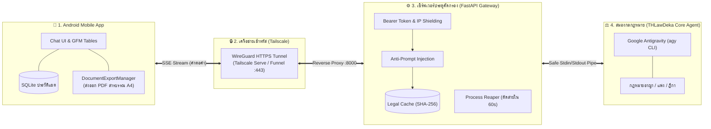

# 🚀 THLawDeka-mobile: คู่มือเริ่มต้นฉบับจับมือทำสำหรับ Windows 11 (Newbie-Proof Step-by-Step Guide for Windows 11)
## สำหรับส่งต่อให้เพื่อนนำไปติดตั้ง ทดสอบ และสั่ง AI พัฒนาบน Windows 11 ตั้งแต่ศูนย์จนใช้งานได้จริง 100%

คู่มือนี้เขียนขึ้นสำหรับผู้เริ่มต้นที่ **ไม่มีพื้นฐานการเขียนโปรแกรมมาก่อน** โดยอธิบายแบบ **"จับมือทำทีละคลิก (Click-by-Click)"** ครบทุกขั้นตอน ตั้งแต่การแตกไฟล์ ติดตั้งโปรแกรม ทดสอบคำสั่ง สั่ง AI พัฒนา ไปจนถึงเปิดใช้งานแอปจริงบนมือถือ พร้อมวิธีรับมือกับปัญหาที่พบบ่อย (Troubleshooting) อย่างละเอียดที่สุดครับ

> 🐧 **สำหรับผู้ใช้ระบบปฏิบัติการ Linux (Ubuntu / Debian / Fedora / Arch):**
> โปรดอ่านคู่มือฉบับเฉพาะของระบบ Linux ได้ที่: [Quick_start_Linux.md](Quick_start_Linux.md)

---

### 📦 สำหรับ "ผู้ส่งไฟล์" (ทำก่อน Zip ส่งให้เพื่อน):
ก่อนกดบีบอัดเป็นไฟล์ `THLawDeka-mobile.zip` ให้ตรวจเช็ก 2 ข้อนี้ เพื่อให้ไฟล์มีขนาดเล็กกะทัดรัด (เพียง 1-2 MB แทนที่จะเป็น 200+ MB):
1. ลบโฟลเดอร์ `backend/.venv` (หากเคยสร้างไว้) ทิ้งก่อน
2. ลบโฟลเดอร์แคช `__pycache__` ต่างๆ ทิ้งก่อน
*(เพื่อนของคุณจะสร้างสภาพแวดล้อมใหม่ที่สะอาดบนเครื่องของเขาเองตามคู่มือนี้ใน 5 วินาทีครับ)*

---

## 🧭 แผนผังภาพรวม 7 ขั้นตอน (ทำตามลำดับนี้ได้เลย):
```text
[ขั้นตอนที่ 1] แตกไฟล์ Zip (พร้อมทริคป้องกันโฟลเดอร์ซ้อน)
      ↓
[ขั้นตอนที่ 2] ติดตั้ง 4 โปรแกรมจำเป็นบน Windows 11 (uv, Python 3.12, Android Studio, Tailscale)
      ↓
[ขั้นตอนที่ 3] ทดสอบเครื่องมือ AI (agy CLI) ในโฟลเดอร์ THLawDeka
      ↓
[ขั้นตอนที่ 4] สร้างสภาพแวดล้อม (.venv) และลงแพ็กเกจในโฟลเดอร์ backend
      ↓
[ขั้นตอนที่ 5] เปิดโปรเจกต์ใน Antigravity Desktop
      ↓
[ขั้นตอนที่ 6] คัดลอกคำสั่ง Master Prompt สั่ง AI เริ่มพัฒนา Phase 1 ถึง Phase 5
      ↓
[ขั้นตอนที่ 7] รันเซิร์ฟเวอร์, เปิดอุโมงค์ Tailscale HTTPS, และเปิดแอปเพื่อใช้งานจริง!
```

---

## 🧠 สถาปัตยกรรมและหลักการทำงานของระบบ (System Architecture & How It Works)

ระบบ **THLawDeka-mobile** คือแพลตฟอร์มผู้ช่วยทนายความและที่ปรึกษากฎหมายไทยอัจฉริยะแบบพกพา ซึ่งออกแบบภายใต้แนวคิด **"ความปลอดภัยสูงสุด ข้อมูลส่วนตัวไม่รั่วไหล และตอบคำถามได้แบบเรียลไทม์"** โดยแบ่งการทำงานออกเป็น **4 ส่วนหลัก** ประสานงานกันอย่างราบรื่น:



### 🔍 หน้าที่ของแต่ละส่วนประกอบ:

1. **📱 ส่วนที่ 1: แอปพลิเคชันบนมือถือ (Android Client - Kotlin Native)**
   * **หน้าจอสนทนา (Real-time SSE Chat UI):** รับและแสดงผลข้อความวิเคราะห์กฎหมายแบบสตรีมมิ่งคำต่อคำ (Streaming Tokens) นุ่มนวล เสมือนมีผู้ช่วยพิมพ์ตอบสด ๆ
   * **การแสดงผลทางกฎหมาย:** แสดงผลตารางเปรียบเทียบมาตรากฎหมาย (GFM Tables) และแผนผังขั้นตอนคดีความ (Mermaid Chart) ผ่านระบบตัดคำภาษาไทยความคมชัดสูง (`BREAK_STRATEGY_HIGH_QUALITY`)
   * **บันทึกข้อมูลแบบออฟไลน์ 100%:** จัดการห้องสนทนา (แชตต่อของเดิม / สร้างแชตใหม่ / ลบแชต) เก็บลงฐานข้อมูล SQLite ในเครื่องมือถือ ไม่มีการส่งประวัติคดีความไปเก็บที่เซิร์ฟเวอร์
   * **ส่งออกเอกสารบนเครื่อง (Zero-Disk-Write Server):** ฟังก์ชัน `DocumentExportManager` แปลงบทสนทนาเป็นเอกสาร **PDF ฟอนต์สารบรรณขนาด A4 มาตรฐานราชการ**, ไฟล์ Markdown (`.md`), หรือข้อความ (`.txt`) และสั่งพิมพ์หรือแชร์ทาง LINE ได้ทันทีจากมือถือ โดยไม่ต้องขอให้เซิร์ฟเวอร์สร้างไฟล์
   * **ค้นหาคดีความออฟไลน์และกู้คืนสตรีม:** รองรับ **SQLite FTS5 Full-Text Search** ค้นหาคำสำคัญในฎีกาเก่าได้ทันทีแม้อยู่ในห้องพิจารณาคดีที่ไม่มีสัญญาณเน็ต พร้อมระบบ **Partial Stream Recovery** บันทึกคำตอบบางส่วนและถามต่อได้ทันทีหากสัญญาณหลุด

2. **🔒 ส่วนที่ 2: เครือข่ายอุโมงค์เข้ารหัส (Tailscale HTTPS Tunnel)**
   * เชื่อมต่อระหว่างโทรศัพท์มือถือกับเครื่องคอมพิวเตอร์ผ่านเครือข่ายส่วนตัวเสมือน (WireGuard Mesh) หรือต่อผ่านอินเทอร์เน็ตสาธารณะด้วย Tailscale Funnel พร้อมใบรับรองความปลอดภัย HTTPS
   * สามารถใช้งานแอปจากนอกบ้านผ่านสัญญาณเน็ต 4G/5G ได้ทันที โดย **ไม่ต้องตั้งค่าเร้าเตอร์หรือเปิดพอร์ตบ้าน (No Port Forwarding)**

3. **⚙️ ส่วนที่ 3: เซิร์ฟเวอร์ประตูคัดกรองความปลอดภัย (FastAPI Gateway & Pipe Controller)**
   * **ตรวจสอบสิทธิ์ฉับไว ($O(1)$ Token Cache):** ตรวจสอบ API Key ของมือถือในหน่วยความจำ RAM อย่างรวดเร็ว ป้องกันการยิงสแปม
   * **ระบบแคชคำถามกฎหมายยอดฮิต (Fast-Path Legal Cache):** หากมีคำถามเดิมที่เคยตอบไว้แล้ว ระบบจะส่งคำตอบกลับทันทีใน 0.05 วินาที โดยไม่ต้องปลุก AI
   * **เกราะป้องกันการเจาะระบบ (Gateway Pre-Filter):** ตรวจจับและสกัดกั้นคำสั่งแฮกหรือ Prompt Injection ก่อนส่งไปยังตัวประมวลผล
   * **ระบบบีบอัดข้อมูลอัจฉริยะ (Selective Gzip):** บีบอัดข้อมูลหน้าเว็บ Admin ประหยัดแบนด์วิดท์ 70-85% แต่ปล่อยเส้นทางสตรีมมิ่งสดให้วิ่งตรงโดยไม่ติดค้างบัฟเฟอร์
   * **Zombie Process Reaper:** หากมือถือปิดจอหรือสัญญาณเน็ตหลุด เซิร์ฟเวอร์จะสั่งตัดโปรเซส AI ทันที ไม่ปล่อยให้ทำงานค้างกินทรัพยากรคอมพิวเตอร์
   * **Zero-PII Audit Logging:** บันทึกเฉพาะเมทริกซ์เชิงตัวเลข (เวลา, ขนาดไบต์, รหัสสถานะ) **ห้ามบันทึกข้อเท็จจริงคดีหรือคำถาม/คำตอบลง Disk Log เด็ดขาด** เพื่อจรรยาบรรณวิชาชีพและ PDPA
   * **Per-Key Rate Limiting:** จำกัดความถี่ไม่เกิน 10 คำขอ/นาทีต่อกุญแจ ป้องกันการสแปมคิว AI (Semaphore)
   * **Automated SQLite Backup:** สำรองข้อมูล `keys.db` อัตโนมัติแบบ Online Backup ย้อนหลัง 7 ชุด
   * **Long-Context Budgeting:** ส่งสัญญาณเตือนเมื่อบริบทคดีสะสมเกิน 64KB เพื่อแนะนำให้ย่อสรุปด้วย `/compact` หรือเปิดห้องแชตใหม่

4. **⚖️ ส่วนที่ 4: สมองกลกฎหมายไทย (THLawDeka Core Agent - Google Antigravity)**
   * ทำงานผ่านคำสั่ง `agy` CLI ในโหมดความปลอดภัยสูง (`--sandbox`)
   * มีทักษะและความรู้ความเชี่ยวชาญเฉพาะทาง (Specialized Skills) เช่น ประมวลกฎหมายอาญา ประมวลกฎหมายแพ่งและพาณิชย์ พระราชบัญญัติเฉพาะทาง และคลังแนวคำพิพากษาศาลฎีกา
   * รับคำถามกฎหมายผ่านท่อส่งข้อมูลมาตรฐาน (`stdin`) และวิเคราะห์ส่งคืนผลลัพธ์ผ่านท่อข้อมูล (`stdout`) โดยไม่มีการเปิดช่องโหว่รันคำสั่งเชลล์ภายนอก (Zero-Shell Execution)

---

### ⏱️ วงจรการทำงานตั้งแต่พิมพ์ถามจนได้คำตอบ (5 ขั้นตอน):
```text
[1] ผู้ใช้พิมพ์คำถามบนมือถือ (เช่น ปรึกษาเรื่องคดีเช่าบ้าน หรือ ม.341)
     ↓
[2] มือถือส่งคำถามผ่าน HTTPS พร้อม API Key เข้าสู่ Gateway
     ↓
[3] Gateway ตรวจสอบความปลอดภัย ตรวจสิทธิ์ และเช็กแคชคำตอบ
     ↓
[4] Gateway ส่งคำถามเข้าสมอง AI (agy) ผ่านท่อ Safe Stdin แบบปลอดภัย
     ↓
[5] สมอง AI สตรีมคำตอบส่งคืนถึงหน้าจอมือถือแบบ Real-time และกดบันทึกเป็น PDF ทันที
```

---

## 🗂️ ขั้นตอนที่ 1: การแตกไฟล์ Zip (พร้อมวิธีป้องกันโฟลเดอร์ซ้อน)

1. เมื่อได้รับไฟล์ `THLawDeka-mobile.zip` ให้บันทึกไว้ในโฟลเดอร์ที่หาง่าย เช่น บนหน้าจอ **Desktop** หรือที่ **`C:\`**
2. **คลิกขวา** ที่ไฟล์ `THLawDeka-mobile.zip` แล้วเลือก **Extract All... (แยกไฟล์ทั้งหมด...)**
3. จะมีหน้าต่างเด้งขึ้นมา ให้กดปุ่ม **Extract** ด้านล่างขวา แล้วรอแถบสีเขียวโหลดจนเสร็จสิ้น
4. ⚠️ **จุดตรวจเช็กสำคัญ (ป้องกันโฟลเดอร์ซ้อน):**
   - ดับเบิลคลิกเปิดโฟลเดอร์ที่แตกออกมาเข้าไปดู **จะต้องเห็นโฟลเดอร์ชื่อ `backend`, `THLawDeka`, `techdocs` และไฟล์ `Quick_start_Windows.md` ทันที**
   - *หากดับเบิลคลิกเข้าไปแล้ว เจอโฟลเดอร์ชื่อ `THLawDeka-mobile` ซ้อนอยู่อีกชั้นหนึ่ง ให้ดับเบิลคลิกเข้าไปข้างในนั้น เพื่อใช้โฟลเดอร์ชั้นในเป็นโฟลเดอร์หลักของโปรเจกต์ครับ*

---

## 🛠️ ขั้นตอนที่ 2: ติดตั้งเครื่องมือจำเป็นบน Windows 11 (ทำครั้งเดียว ใช้ได้ตลอดไป)

บน Windows 11 คุณสามารถติดตั้งทุกอย่างผ่านคำสั่งง่าย ๆ ใน Terminal ได้ทันที:

### 🔹 2.1 ติดตั้ง `uv` และ `Python 3.12`
1. กดปุ่ม **Windows (⊞)** บนคีย์บอร์ด แล้วพิมพ์คำว่า `terminal`
2. คลิกเปิดโปรแกรม **Terminal** (หน้าต่างสีดำจะปรากฏขึ้นมา)
3. คัดลอกคำสั่งนี้ไปวาง (คลิกขวาใน Terminal เพื่อวาง) แล้วกดปุ่ม **Enter**:
   ```powershell
   winget install --id astral-sh.uv
   ```
   *(หากมีข้อความขึ้นมาถามความยินยอม เช่น `Do you agree to all the source agreements terms?` ให้พิมพ์ตัว `Y` แล้วกด Enter)*
   
   > 💡 *สำรอง (หากเครื่องใดใช้ winget ไม่ได้):* ให้คัดลอกคำสั่งนี้ไปวางแทน:
   > `powershell -ExecutionPolicy ByPass -c "irm https://astral.sh/uv/install.ps1 | iex"`

4. 🔴 **สำคัญมาก:** เมื่อติดตั้งเสร็จ ให้ **ปิดหน้าต่าง Terminal นั้นทิ้ง แล้วเปิด Terminal ใหม่อีกครั้ง** (เพื่อให้ระบบจำค่าโปรแกรมใหม่)
5. ในหน้าต่าง Terminal ใหม่ ให้คัดลอกคำสั่งนี้ไปวาง แล้วกด **Enter**:
   ```powershell
   uv python install 3.12
   ```
   *(รอประมาณ 10-20 วินาที หน้าจอจะขึ้นว่า `Installed Python 3.12` เป็นอันเสร็จสิ้นเรียบร้อย)*
   
   > ❓ **ทำไมต้อง Python 3.12?** เพราะเป็นเวอร์ชันที่เสถียรที่สุด แพ็กเกจ AI และ FastAPI ทำงานเข้ากันได้ 100% และคำสั่งนี้จะจัดการดาวน์โหลดให้ทันทีโดยไม่มีหน้าต่าง Microsoft Store มากวนใจ

---

### 🔹 2.2 ติดตั้ง Google Antigravity Desktop (โปรแกรมควบคุม AI Agent)
1. ดาวน์โหลดโปรแกรม **Antigravity Desktop** จากเว็บไซต์ทางการ: [https://antigravity.google](https://antigravity.google)
2. ดับเบิลคลิกเปิดไฟล์ติดตั้ง ทำตามขั้นตอนบนหน้าจอ แล้วเปิดโปรแกรมขึ้นมา
3. ล็อกอินด้วยบัญชี Google ของคุณให้เรียบร้อย (ตัวโปรแกรมจะติดตั้งคำสั่ง `agy` CLI ในเครื่องให้อัตโนมัติ)
4. *หลังจากเปิด Antigravity ครั้งแรกแล้ว ให้ปิดหน้าต่าง Terminal เก่า แล้วเปิดใหม่ เพื่อให้คำสั่ง `agy` ใช้งานได้บนคอมพิวเตอร์ของคุณ*

---

### 🔹 2.3 ติดตั้ง Android Studio (โปรแกรมสำหรับเปิดแอปมือถือ)
1. ดาวน์โหลดโปรแกรม **Android Studio** จากเว็บไซต์: [https://developer.android.com/studio](https://developer.android.com/studio)
2. เปิดไฟล์ติดตั้ง กดปุ่ม **Next** ไปเรื่อย ๆ ตามค่ามาตรฐานจนกระทั่งติดตั้งเสร็จ
3. เปิด Android Studio ขึ้นมาครั้งแรก โปรแกรมจะดาวน์โหลดชุดเครื่องมือ SDK ให้อัตโนมัติ รอจนแถบโหลดเสร็จสิ้น
   > 📱 *หมายเหตุ: คุณไม่จำเป็นต้องมีโทรศัพท์ Android จริงก็ได้ เพราะ Android Studio มีเครื่องจำลองมือถือ (Emulator) ให้ใช้งานบนจอคอมพิวเตอร์ได้ฟรีทันทีครับ*
---

### 🔹 2.4 ติดตั้งและเข้าสู่ระบบ Tailscale (ระบบเครือข่ายความปลอดภัยสำหรับต่อมือถือ)
1. ในหน้าต่าง Terminal ให้คัดลอกคำสั่งนี้ไปวาง แล้วกด **Enter**:
   ```powershell
   winget install --id Tailscale.Tailscale
   ```
   *(หรือดาวน์โหลดตัวติดตั้งได้จากเว็บไซต์ทางการ: [https://tailscale.com/download/windows](https://tailscale.com/download/windows))*
2. เมื่อติดตั้งเสร็จ ให้กดปุ่ม **Windows (⊞)** แล้วพิมพ์ `tailscale` เพื่อเปิดโปรแกรมขึ้นมา
3. คลิกไอคอน Tailscale ที่มุมล่างขวาของจอ (System Tray) แล้วเลือก **Log in...**
4. หน้าต่างเว็บเบราว์เซอร์จะเปิดขึ้นมา ให้ล็อกอินด้วยบัญชี Google หรือ Microsoft ของคุณให้เรียบร้อย
5. โปรแกรมจะขึ้นสถานะเชื่อมต่อสำเร็จ แปลว่าคอมพิวเตอร์ของคุณพร้อมเชื่อมต่อกับมือถือแล้วครับ!


---

## ⚖️ ขั้นตอนที่ 3: ทดสอบการทำงานของ `agy` CLI ในโฟลเดอร์ `THLawDeka`

ขั้นตอนนี้ทำเพื่อ **ทดสอบว่าระบบ AI ผู้เชี่ยวชาญกฎหมายในเครื่องของเราพร้อมทำงานจริง 100%**:

> 💡 **ทริคเด็ดสำหรับ Windows 11 (วิธีเปิด Terminal ในโฟลเดอร์เป้าหมายทันทีโดยไม่ต้องพิมพ์คำสั่ง cd):**
> 1. เปิดเข้าไปในโฟลเดอร์ `THLawDeka-mobile` แล้วดับเบิลคลิกเข้าไปในโฟลเดอร์ `THLawDeka`
> 2. มองไปที่ **แถบที่อยู่ด้านบนของหน้าต่าง (Address Bar)** ที่แสดงว่าเรากำลังอยู่โฟลเดอร์ไหน
> 3. คลิกเมาส์ 1 ครั้งตรงพื้นที่ว่างบนแถบด้านบน พิมพ์คำว่า `powershell` แล้วกด **Enter**
> 4. หน้าต่าง Terminal สีดำจะเปิดขึ้นมาที่โฟลเดอร์ `THLawDeka` ทันที!

5. ในหน้าต่าง Terminal ที่เพิ่งเปิดขึ้นมา ให้คัดลอกคำสั่งนี้ไปวาง แล้วกด **Enter**:
   ```powershell
   agy -p "คดีฉ้อโกงตามประมวลกฎหมายอาญา มาตรา 341 มีองค์ประกอบความผิดอย่างไร" --sandbox --input-format text --output-format stream-json
   ```
   *(หมายเหตุ: ต้องส่งข้อความในเครื่องหมายคำพูดผ่านพารามิเตอร์ `-p "..."` โดยตรง เพื่อป้องกันปัญหาระบบแสดงผลภาษาไทยผิดพลาดใน Windows PowerShell)*
6. **ผลลัพธ์ที่ถูกต้อง:** หน้าจอจะเริ่มสตรีมข้อความวิเคราะห์กฎหมายตอบกลับมาทีละบรรทัด พร้อมระบุข้อกฎหมายและแนวคำพิพากษาศาลฎีกา แปลว่าระบบ AI กฎหมายในเครื่องพร้อมทำงานสมบูรณ์แล้ว!
7. ปิดหน้าต่าง Terminal นี้ได้เลยครับ

---

## 🐍 ขั้นตอนที่ 4: สร้างสภาพแวดล้อม (`.venv`) และลงแพ็กเกจในโฟลเดอร์ `backend`

ขั้นตอนนี้คือการ **เตรียมพื้นที่สำหรับรันระบบเซิร์ฟเวอร์ Gateway** บนเครื่องของคุณ:

1. ใช้ทริคเดิม: เปิดเข้าไปในโฟลเดอร์ `backend`
2. คลิกที่แถบที่อยู่ด้านบน (Address Bar) พิมพ์ `powershell` แล้วกด **Enter**
3. คัดลอกคำสั่งนี้ไปวางเพื่อสร้าง Virtual Environment ด้วย Python 3.12:
   ```powershell
   uv venv --python 3.12
   ```
   *(เมื่อรันเสร็จ คุณจะเห็นโฟลเดอร์ใหม่ชื่อ `.venv` โผล่ขึ้นมาในโฟลเดอร์ `backend` ทันที)*
4. คัดลอกคำสั่งนี้ไปวางเพื่อติดตั้งแพ็กเกจเซิร์ฟเวอร์ทั้งหมด:
   ```powershell
   uv pip install -r requirements.txt
   ```
   *(หน้าจอจะแสดงหลอดดาวน์โหลด และขึ้นข้อความสีเขียวว่า `Installed 5 packages in ...` เสร็จสิ้นในเวลาเพียง 1-2 วินาที)*
5. ปิดหน้าต่าง Terminal นี้ได้เลยครับ

---

## 💻 ขั้นตอนที่ 5: เปิดโปรเจกต์ใน Antigravity Desktop

1. เปิดโปรแกรม **Antigravity Desktop**
2. มองไปที่มุมซ้ายบน คลิกที่เมนู **File -> Open Folder...** (หรือ Open Workspace...)
3. เลือกโฟลเดอร์หลัก **`THLawDeka-mobile`** (โฟลเดอร์ที่มีโฟลเดอร์ย่อย `backend`, `THLawDeka`, `techdocs`) แล้วกดปุ่ม **Select Folder**
4. หากมีหน้าต่างขึ้นมาถามว่า *"Do you trust the authors of the files in this folder?"* ให้คลิกเลือก **Yes, I trust the authors (ไว้วางใจ)**
5. หน้าจอจะพร้อมใช้งาน:
   - ด้านซ้ายมือ: จะเห็นโครงสร้างไฟล์ทั้งหมดของโปรเจกต์
   - ด้านขวามือ: จะเป็น **หน้าต่างแชต (Chat Panel)** สำหรับสั่งงานทีม AI Agent (หากไม่เห็นหน้าต่างแชต ให้กดปุ่มไอคอน Chat ที่มุมบนขวา หรือกดคีย์ลัด `Ctrl + L`)

---

## 🤖 ขั้นตอนที่ 6: สั่งให้ AI Agent พัฒนาตั้งแต่ Phase 1 ถึง Phase 5 (Copy & Paste คำสั่งเดียว!)

ในหน้าต่างแชตของ **Antigravity Desktop** ทางขวามือ ให้ **คัดลอกข้อความในกรอบด้านล่างนี้ทั้งหมด** ไปวางในช่องพิมพ์ข้อความ แล้วกดปุ่ม **Enter (หรือคลิกไอคอนส่งข้อความ)**:

```text
สวัสดีทีมงาน Antigravity ให้เริ่มดำเนินการพัฒนาโปรเจกต์ THLawDeka-mobile ตามแผนปฏิบัติการ 5 เฟสที่ระบุไว้ในเอกสาร techdocs/system_spec_and_implementation_plan.md โดยยึดถือกฎเหล็กใน AGENTS.md อย่างเคร่งครัด:

1. ดำเนินการตามลำดับทีละเฟส:
   - Phase 1: Local Harness Pipe Test (ทดสอบ safe stdin pipe ของ agy CLI ใน THLawDeka/)
   - Phase 2: FastAPI Gateway & SSE (สร้าง backend/main.py, auth_db.py, Selective Gzip, และ Admin UI)
   - Phase 3: Tailscale HTTPS Setup (จัดเตรียมคำสั่ง Serve และ Funnel พร้อม Admin Reverse Proxy IP Shielding)
   - Phase 4: Android App Integration (สร้างโค้ด Kotlin ใน android/ สำหรับ OkHttp SSE, Markwon, Mermaid WebView, และ 100% Client-side DocumentExportManager)
   - Phase 5: E2E Verification & Hardening (ทดสอบ Zombie Reaper, CLI Flag Regex, และรัน scratch/verify_all.py)

2. กฎเหล็กที่ต้องปฏิบัติอย่างเข้มงวด:
   - Zero-Test by Default: ห้ามสร้างหรือรัน unit tests เอง เว้นแต่จะได้รับคำสั่งเฉพาะเจาะจง ให้ตรวจสอบโค้ดผ่าน python -m py_compile เท่านั้น
   - No Gradle Build: ห้ามรันคำสั่ง ./gradlew หรือ gradle ในเทอร์มินัลเด็ดขาด (ฉันจะเปิดบิลด์ผ่าน Android Studio ด้วยตัวเอง)
   - Server-Side Zero-Disk-Write: เซิร์ฟเวอร์ทำงานแบบ Read-Only ห้ามเขียนไฟล์ลงดิสก์เซิร์ฟเวอร์
   - 100% Portability: ใช้เฉพาะ Relative Paths ห้ามมี Hardcoded Absolute Path

ให้เริ่มดำเนินการจาก Phase 1 ทันที และรายงานความคืบหน้าเชิงประจักษ์เมื่อแต่ละเฟสสำเร็จ!
```

> ⚠️ **ข้อควรระวังสำคัญที่สุดในขั้นตอนนี้ (สำหรับมือใหม่):**
> - ระหว่างที่ AI กำลังสร้างโค้ดและรันสคริปต์ ระบบจะมีหน้าต่างถามขออนุมัติการทำงาน (เช่น **"Proceed"**, **"Allow"**, หรือ **"Run Command"**) ปรากฏขึ้นมา
> - **ให้คลิกปุ่ม Proceed หรือ Always Allow ได้เลยครับ** หากไม่คลิก AI จะหยุดรอคำอนุมัติจากคุณ
> - นั่งดู AI ทำงานประมาณ 2-3 นาที จนกว่า AI จะแจ้งว่า **"พัฒนาเสร็จสมบูรณ์ครบทั้ง 5 เฟส และผ่านการตรวจสอบ 0 errors"** ครับ

---

## 🚀 ขั้นตอนที่ 7: การเปิดใช้งานจริงเมื่อ AI พัฒนาเสร็จ

### 🔹 7.1 การกำหนดรหัสผ่าน Admin และเปิดเซิร์ฟเวอร์ Backend (Admin Password Configuration)

เซิร์ฟเวอร์ Backend มีระบบป้องกันหน้าจอผู้ดูแลระบบ (`/admin`) ด้วย Master Secret โดยถูกควบคุมผ่านตัวแปรสภาพแวดล้อม (Environment Variable) ชื่อ **`ADMIN_SECRET`**:

#### 🔑 ข้อมูลรหัสผ่าน Admin (Zero-Hardcoded Secrets Policy):
เพื่อความมั่นคงปลอดภัยสูงสุด ระบบ **ไม่มีการฮาร์ดโค้ดรหัสผ่านไว้ในซอร์สโค้ด (Zero-Hardcoded Secrets)** เพื่อป้องกันช่องโหว่ CWE-798:
* **วิธีที่ 1 (แนะนำ - กำหนดรหัสผ่านของคุณเอง):** ระบุรหัสผ่านที่ต้องการผ่านตัวแปร `$env:ADMIN_SECRET` ในคำสั่งรัน
* **วิธีที่ 2 (สะดวก ปลอดภัยสูง):** หากไม่ได้กำหนดรหัสผ่านไว้ ระบบจะ **สุ่มสร้างรหัสผ่านความปลอดภัยสูงให้อัตโนมัติ (เช่น `thlaw_admin_x9K...`)** โดยจะพิมพ์แสดงเด่นชัดบนหน้าต่าง Terminal ทันทีที่เซิร์ฟเวอร์เปิด และบันทึกเก็บไว้ในไฟล์ `backend/.admin_secret` (ไม่ถูกส่งขึ้น Git)

---

#### 🚀 วิธีเปิดเซิร์ฟเวอร์ (เลือกได้ 2 แบบตามความสะดวก):
1. เปิดเข้าไปในโฟลเดอร์ `backend` คลิกที่แถบที่อยู่ด้านบน พิมพ์ `powershell` แล้วกด Enter
2. เลือกรันคำสั่งแบบใดแบบหนึ่ง:
   * **แบบที่ 1 (กำหนดรหัสผ่าน Admin ด้วยตนเอง - แนะนำ):**
     ```powershell
     $env:ADMIN_SECRET="ใส่รหัสผ่านใหม่ที่คุณต้องการตรงนี้"; uv run uvicorn main:app --host 127.0.0.1 --port 8000
     ```
   * **แบบที่ 2 (ให้ระบบสุ่มสร้างรหัสผ่านอัตโนมัติ):**
     ```powershell
     uv run uvicorn main:app --host 127.0.0.1 --port 8000
     ```
     *(ระบบจะพิมพ์รหัสผ่านสุ่ม เช่น `thlaw_admin_...` บนหน้าจอ Terminal ให้คุณคัดลอกไปใช้งานได้ทันที)*
   *(เมื่อรันแล้ว หน้าจอจะขึ้นข้อความว่า `Uvicorn running on http://127.0.0.1:8000` แปลว่าเซิร์ฟเวอร์เปิดทำงานแล้ว **ห้ามปิดหน้าต่างนี้ทิ้งนะครับ**)*

---

#### 📋 เข้าหน้า Admin Web UI เพื่อสร้างกุญแจ API Key:
3. เปิดเว็บเบราว์เซอร์ (Chrome หรือ Edge) ไปที่ลิงก์:
   👉 **`http://127.0.0.1:8000/admin`**
4. ในช่อง **Master Admin Secret** ให้กรอกรหัสผ่านที่คุณตั้งไว้ (หรือคัดลอกรหัสผ่านสุ่มที่ระบบพิมพ์แสดงบนหน้าต่าง Terminal / ไฟล์ `backend/.admin_secret`) แล้วกดปุ่ม **โหลดข้อมูล / เข้าสู่ระบบ**
5. ในช่องระบุชื่อผู้ใช้ ให้พิมพ์ชื่อของคุณ (เช่น "นายสมชาย") แล้วกดปุ่มสีเขียว **`+ สร้าง Key ใหม่`**
6. คุณจะได้รับรหัสกุญแจยาว ๆ เช่น `thlaw_live_1a2b3c4d5e...` ให้คลิกปุ่ม 📋 **คัดลอกกุญแจนี้เก็บไว้** สำหรับนำไปใส่ในแอปมือถือ

---

### 🔹 7.2 เปิดใช้งานอุโมงค์ความปลอดภัย Tailscale HTTPS (เลือก Serve หรือ Funnel)

หลังจากเซิร์ฟเวอร์ Backend รันอยู่ที่พอร์ต 8000 ในข้อ 7.1 ให้เปิด Terminal ใหม่อีก 1 หน้าต่าง เพื่อสั่งให้ Tailscale ทำการเข้ารหัสและสร้างที่อยู่ HTTPS สำหรับเชื่อมต่อกับโทรศัพท์มือถือ:

> 💡 **เลือกระหว่าง 2 ทางเลือกตามลักษณะการใช้งาน:**

#### ทางเลือกที่ 1: Tailscale Serve (ปลอดภัยสูงสุดสำหรับใช้ส่วนบุคคล - Private Tailnet Mesh)
* เหมาะสำหรับกรณีที่คุณติดตั้งแอป **Tailscale** บนโทรศัพท์มือถือด้วย และล็อกอินด้วยบัญชีเดียวกัน
* คำสั่งเปิดใช้งาน:
  ```powershell
  tailscale serve --bg https / http://127.0.0.1:8000
  ```
* **ผลลัพธ์:** ปิดการเข้าถึงจากสาธารณะ 100% มีเพียงอุปกรณ์ในวง Tailnet ของคุณเท่านั้นที่เข้าถึงได้ โดยมีที่อยู่เป็นชื่อคอมพิวเตอร์ของคุณ เช่น `https://my-pc.tailnet.ts.net`

#### ทางเลือกที่ 2: Tailscale Funnel (สะดวกที่สุด - ไม่ต้องเปิด VPN บนมือถือ / Public HTTPS)
* เหมาะสำหรับกรณีที่ต้องการแชร์ให้เพื่อนใช้ หรือต้องการใช้เน็ต 4G/5G นอกบ้านโดย **ไม่ต้องติดตั้ง/เปิดแอป Tailscale บนมือถือ**
* คำสั่งเปิดใช้งาน:
  ```powershell
  tailscale funnel --bg 443 on
  ```
* **ผลลัพธ์:** คุณจะได้รับลิงก์ HTTPS สาธารณะ (เช่น `https://my-pc.tailnet.ts.net`) นำลิงก์นี้ไปใส่ในแอปมือถือใช้งานได้ทันทีจากทุกที่ทั่วโลก
* 🛡️ **ความปลอดภัย:** ระบบมี **IP Shielding** สกัดกั้นคนแปลกหน้าไม่ให้เข้าถึงหน้า `/admin` โดยอัตโนมัติ และคำขอเข้าห้องแชตทั้งหมดต้องมี API Key ที่ถูกต้องเท่านั้น

> 🔍 **ตรวจสอบสถานะ Tailscale:** สามารถพิมพ์คำสั่ง `tailscale serve status` เพื่อดูลิงก์ HTTPS ปัจจุบันได้ตลอดเวลา

---

### 🔹 7.3 เปิดแอปใน Android Studio และเริ่มใช้งานบนมือถือ
1. เปิดโปรแกรม **Android Studio**
2. เลือกเมนู **File -> Open...** แล้วเลือกโฟลเดอร์ **`android`** ภายในโฟลเดอร์โปรเจกต์ของเรา
3. ครั้งแรก Android Studio จะทำการดาวน์โหลดและเชื่อมโยงชุดคำสั่ง (Gradle Sync) ให้ **สังเกตแถบดาวน์โหลดด้านล่างขวา รอจนแถบโหลดทำงานเสร็จสิ้น** (ประมาณ 1-2 นาที)
4. เลือกว่าจะทดสอบด้วยวิธีใด:
   * **ทางเลือก A (ง่ายที่สุด - ใช้เครื่องจำลองบนคอมพิวเตอร์ / Emulator):**
     - มองไปที่แถบด้านบน คลิกที่เมนูเลือกอุปกรณ์ แล้วเลือก **Pixel 8 Pro (หรือสร้างอุปกรณ์จำลองใหม่ใน Device Manager)**
     - กดปุ่ม **Run (รูปสามเหลี่ยมสีเขียว ▶️)** ที่แถบด้านบน
     - หน้าต่างโทรศัพท์จำลองจะเปิดขึ้นมาบนหน้าจอคอมพิวเตอร์ของคุณ
   * **ทางเลือก B (ใช้โทรศัพท์ Android จริงผ่านสาย USB):**
     - เปิดมือถือจริงของคุณ เข้าไปที่ **การตั้งค่า (Settings) -> เกี่ยวกับโทรศัพท์ (About Phone)** แล้วแตะที่คำว่า **หมายเลขบิลด์ (Build Number)** ซ้ำ ๆ กัน 7 ครั้ง จนขึ้นว่า "คุณเป็นนักพัฒนาแล้ว"
     - กลับมาที่หน้าการตั้งค่าหลัก เข้าเมนู **ตัวเลือกสำหรับนักพัฒนา (Developer Options) -> เปิดสวิตช์ การแก้ไขข้อบกพร่อง USB (USB Debugging)**
     - เสียบสาย USB ต่อโทรศัพท์เข้ากับคอมพิวเตอร์ (หากโทรศัพท์ถามขออนุญาต ให้แตะ "อนุญาต / Always allow from this computer")
     - ใน Android Studio จะเห็นชื่อรุ่นมือถือของคุณปรากฏขึ้นมา ให้กดปุ่ม **Run (รูปสามเหลี่ยมสีเขียว ▶️)**
5. เมื่อแอปพลิเคชัน THLawDeka ติดตั้งและเปิดขึ้นมาบนหน้าจอ:
   - แตะที่เมนู **Settings (ไอคอนรูปฟันเฟือง ⚙️)** ที่มุมบนขวา
   - ในช่อง **API Key:** ให้นำรหัสกุญแจ `thlaw_live_...` ที่เราคัดลอกไว้ในข้อ 7.1 มาวาง
   - ในช่อง **Server URL:**
     - *หากใช้เครื่องจำลอง (Emulator):* ให้ใส่ `http://10.0.2.2:8000` (เป็นไอพีจำลองพิเศษของระบบแอนดรอยด์สำหรับต่อคอมพิวเตอร์)
     - *หากใช้มือถือจริงต่อ Wi-Fi ในบ้าน:* ให้ใส่ไอพีของเครื่องคอมพิวเตอร์ เช่น `http://192.168.1.50:8000` (ดูไอพีคอมได้ง่าย ๆ โดยพิมพ์ `ipconfig` ใน Terminal)
     - *หากต่อผ่าน Tailscale (Serve หรือ Funnel ในข้อ 7.2):* ให้ใส่ลิงก์ HTTPS ของคุณ เช่น `https://my-pc.tailnet.ts.net`
   - กดปุ่ม **Save (บันทึก)**
6. แตะกลับมาที่หน้าแชตหลัก แล้วพิมพ์คำถามปรึกษากฎหมายได้ทันที เช่น:
   > *"ผู้เช่าค้างค่าเช่า 3 เดือน เจ้าของบ้านมีสิทธิตัดน้ำตัดไฟและล็อกกุญแจห้องเช่าได้หรือไม่"*
7. คุณจะเห็นตัวอักษรพิมพ์ตอบออกมาสด ๆ แบบสตรีมมิ่งคำต่อคำ พร้อมตารางมาตรากฎหมาย และสามารถแตะปุ่ม **Export** ด้านบน เพื่อแปลงคำตอบเป็นเอกสาร **PDF ฟอนต์สารบรรณขนาด A4** บันทึกเก็บไว้หรือแชร์ทาง LINE ได้ทันทีครับ!

---

## ❓ 7 ปัญหาที่พบบ่อยและวิธีแก้ง่าย ๆ (Troubleshooting)

1. **ถาม: พิมพ์คำสั่ง `winget` หรือ `uv` แล้วขึ้นสีแดงว่า "is not recognized as an internal or external command"?**
   * **ตอบ:** เกิดจากการที่เพิ่งลงโปรแกรมเสร็จ แต่ยังไม่ได้รีสตาร์ท Terminal ให้ **ปิดหน้าต่าง Terminal นั้นทิ้ง แล้วเปิด Terminal ขึ้นมาใหม่** ก็จะพิมพ์คำสั่งได้ทันทีครับ

2. **ถาม: พิมพ์ `agy` แล้วระบบหาไม่เจอ?**
   * **ตอบ:** ตรวจสอบว่าได้เปิดโปรแกรม **Antigravity Desktop** ขึ้นมาล็อกอินแล้วหรือยัง เมื่อล็อกอินแล้ว ให้ปิดและเปิดหน้าต่าง Terminal ใหม่อีกครั้งครับ

3. **ถาม: สั่ง AI ใน Antigravity Desktop แล้วทำไมนิ่งไป ไม่ยอมพิมพ์โค้ดต่อ?**
   * **ตอบ:** กวาดสายตามองในหน้าต่างแชต มักจะมีปุ่มถามความยินยอมสีฟ้าหรือสีเขียว เช่น **"Proceed"** หรือ **"Allow"** รอให้คุณคลิกอยู่ ให้กดคลิกอนุมัติ AI ก็จะทำงานต่อทันทีครับ

4. **ถาม: เสียบสายโทรศัพท์ Android เข้าคอมแล้ว แต่ใน Android Studio ไม่ขึ้นชื่อโทรศัพท์?**
   * **ตอบ:** ตรวจดูว่าได้เปิดโหมด **USB Debugging** ใน Developer Options ของมือถือหรือยัง และตรวจดูหน้าจอมือถือว่ามีหน้าต่างถามขออนุญาตเชื่อมต่อคอมพิวเตอร์หรือไม่ ให้แตะ "อนุญาต (Allow)"

5. **ถาม: ทำไมในแอปมือถือส่งข้อความแล้วขึ้นว่า "Connection Refused" หรือเชื่อมต่อเซิร์ฟเวอร์ไม่ได้?**
   * **ตอบ:** ตรวจสอบ 2 ข้อนี้:
     1. หน้าต่าง Terminal ที่รันคำสั่ง `uv run uvicorn ...` ในข้อ 7.1 ยังเปิดอยู่หรือไม่ (ห้ามปิดหน้าต่างนี้)
     2. ตรวจสอบช่อง Server URL ในหน้า Settings ของแอป: หากใช้ Emulator ในคอมพิวเตอร์ ต้องพิมพ์ `http://10.0.2.2:8000` (ห้ามพิมพ์ localhost)

6. **ถาม: ถ้าอยากนำมือถือไปใช้นอกบ้านผ่านเน็ต 4G/5G ต้องทำอย่างไร?**
   * **ตอบ:** เปิด Terminal บนคอมพิวเตอร์ แล้วรันคำสั่ง `tailscale funnel --bg 443 on` คอมพิวเตอร์ของคุณจะได้รับลิงก์ HTTPS สาธารณะมา 1 ลิงก์ (เช่น `https://my-pc.tailnet.ts.net`) ให้นำลิงก์นี้ไปใส่ในช่อง Server URL ของแอป เพียงเท่านี้มือถือของคุณก็จะคุยกับคอมที่บ้านได้จากทุกที่ทั่วโลกอย่างปลอดภัย 100% ครับ!

7. **ถาม: ลืมรหัสผ่าน Admin หรืออยากเปลี่ยนรหัสผ่าน Backend Admin ต้องทำอย่างไร?**
   * **ตอบ:** หากคุณไม่ได้ตั้งรหัสผ่านเอง สามารถเปิดดูรหัสผ่านสุ่มที่ระบบสร้างไว้ในไฟล์ `backend/.admin_secret` หรือหากต้องการเปลี่ยนรหัสผ่านใหม่ ให้กด `Ctrl + C` ปิดเซิร์ฟเวอร์เดิม แล้วสั่งเปิดใหม่พร้อมระบุรหัสผ่านใหม่ได้ทันที:
     ```powershell
     $env:ADMIN_SECRET="รหัสผ่านใหม่ของคุณ"; uv run uvicorn main:app --host 127.0.0.1 --port 8000
     ```

---

## 📚 เอกสารอ้างอิงเพิ่มเติม
- เอกสารข้อกำหนดระบบฉบับเต็ม: [techdocs/system_spec_and_implementation_plan.md](techdocs/system_spec_and_implementation_plan.md)
- กฎการทำงานของทีม Agent: [AGENTS.md](AGENTS.md)
