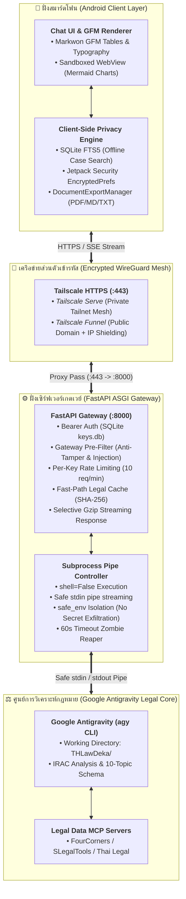

# ⚖️📱 THLawDeka-mobile: Mobile Legal AI Assistant & Enterprise ASGI Gateway

**ระบบผู้ช่วยทนายความและที่ปรึกษากฎหมายไทยอัจฉริยะบนสมาร์ตโฟน แอนดรอยด์ (Thai Legal Intelligence Advisor on Mobile)**  
*ผสานพลังการวิเคราะห์กฎหมายระดับองค์กรของ Google Antigravity เข้ากับสถาปัตยกรรมความปลอดภัยระดับสูงและเครือข่ายส่วนตัว Tailscale WireGuard Mesh*

---

## 📑 สารบัญ (Table of Contents)
- [1. 🌟 ภาพรวมโครงการ (Project Overview)](#1--ภาพรวมโครงการ-project-overview)
- [2. 🏛️ สถาปัตยกรรมระบบ (System Architecture)](#2-️-สถาปัตยกรรมระบบ-system-architecture)
- [3. 📂 โครงสร้าง Monorepo (Repository Structure)](#3--โครงสร้าง-monorepo-repository-structure)
- [4. 🛡️ เสาหลักด้านความปลอดภัย 5 ชั้น (5-Layer Threat Model & Security)](#4-️-เสาหลักด้านความปลอดภัย-5-ชั้น-5-layer-threat-model--security)
- [5. ⚡ จุดเด่นและฟีเจอร์สำคัญ (Core Highlights & Capabilities)](#5--จุดเด่นและฟีเจอร์สำคัญ-core-highlights--capabilities)
- [6. 🚀 คู่มือเริ่มต้นใช้งานฉบับจับมือทำ (Quick Start Guides)](#6--คู่มือเริ่มต้นใช้งานฉบับจับมือทำ-quick-start-guides)
- [7. 👥 ทีมปัญญาประดิษฐ์และการบริหารจัดการ (AI Multi-Agent Governance)](#7--ทีมปัญญาประดิษฐ์และการบริหารจัดการ-ai-multi-agent-governance)
- [8. 🔑 ข้อกำหนดและสิ่งจำเป็นล่วงหน้า (Prerequisites & API Keys)](#8--ข้อกำหนดและสิ่งจำเป็นล่วงหน้า-prerequisites--api-keys)
- [9. ⚖️ ข้อจำกัดความรับผิดชอบ (Legal Disclaimer)](#9-️-ข้อจำกัดความรับผิดชอบ-legal-disclaimer)

---

## 🌟 1. ภาพรวมโครงการ (Project Overview)

**THLawDeka-mobile** คือแพลตฟอร์มระดับองค์กรที่ยกระดับขีดความสามารถของ **THLawDeka** (ระบบวิเคราะห์คำพิพากษาศาลฎีกาและข้อกฎหมายไทย 10 หัวข้อตามกรอบ IRAC) ให้สามารถนำไปใช้งานได้จริงอย่างคล่องตัว รวดเร็ว และปลอดภัยบนสมาร์ตโฟน Android ทุกที่ทุกเวลา

โครงการนี้ถูกพัฒนาขึ้นในรูปแบบ **Monorepo** ที่ผสานการทำงาน 3 ส่วนหลักเข้าด้วยกัน:
1. **Core Legal AI Intelligence — Mobile Engine Edition ([`THLawDeka/`](THLawDeka/))**: ปัญญาประดิษฐ์วิเคราะห์ข้อกฎหมายเวอร์ชันปรับแต่งพิเศษเฉพาะสำหรับทำงานร่วมกับ Mobile Client Gateway (สื่อสารผ่าน Safe stdin, ปฏิเสธการรันคำสั่ง OS/Shell ตามกฎ Zero-Shell, และปฏิบัติตามนโยบาย Server-Side Zero-Disk-Write โดยส่งผลลัพธ์ผ่านสตรีมเพื่อให้แอปพลิเคชันมือถือนำไปเรนเดอร์และส่งออกไฟล์บนตัวเครื่อง 100%) แยกสายการพัฒนาเป็นเอกเทศจากเวอร์ชัน Desktop CLI
2. **Enterprise FastAPI ASGI Gateway ([`backend/`](backend/))**: เกตเวย์ตัวกลางที่ควบคุม Subprocess Pipe ของ `agy` ผ่าน Standard Input (`stdin`) อย่างรัดกุม ปราศจากช่องโหว่ RCE รองรับการสตรีมคำตอบแบบ Server-Sent Events (SSE) พร้อมบีบอัด Gzip, Fast-Path Legal Cache, Zero-PII Audit Logging, Per-Key Rate Limiting, และหน้าจัดการ Admin Web UI
3. **Native Android Client (`android/`)**: แอปพลิเคชันมือถือภาษา Kotlin (Target SDK 36) ออกแบบให้ประหยัดทรัพยากร (APK ขนาดกะทัดรัด < 15MB) รองรับการแสดงผลตาราง GFM ผ่าน Markwon, แผนผังกฎหมาย Mermaid ใน Sandboxed WebView, ประวัติแชต SQLite ออฟไลน์พร้อมระบบค้นหาข้อความเต็มรูปแบบ (FTS5), และการส่งออกเอกสารรายงานคำปรึกษาเป็น `.pdf` (มาตรฐานสารบรรณ A4), `.md` หรือ `.txt` บนตัวเครื่อง 100% *(เริ่มสร้างและพัฒนาใน Phase 4)*

---

## 🏛️ 2. สถาปัตยกรรมระบบ (System Architecture)

ระบบถูกออกแบบภายใต้หลักการ **Zero-Trust Network & Local-First Privacy** เพื่อปกป้องความลับในคดีความของผู้รับคำปรึกษา:



---

## 📂 3. โครงสร้าง Monorepo (Repository Structure)

```text
THLawDeka-mobile/
├── README.md                      # ภาพรวมโครงการและสถาปัตยกรรม (ไฟล์นี้)
├── Quick_start_Windows.md         # คู่มือติดตั้งและทดสอบฉบับจับมือทำสำหรับ Windows 11
├── Quick_start_Linux.md           # คู่มือติดตั้งและทดสอบฉบับจับมือทำสำหรับ Linux (Ubuntu/Debian)
├── AGENTS.md                      # ข้อกำหนด ธรรมาภิบาล และหน้าที่ของทีม AI Subagents
├── .gitignore                     # กฎยกเว้นไฟล์ของระบบ Git (ความลับ, ฐานข้อมูล, Build SDKs)
├── techdocs/
│   └── system_spec_and_implementation_plan.md  # พิมพ์เขียวทางเทคนิคและแผนการพัฒนา 5 เฟส
├── THLawDeka/                     # ⚖️ [Core AI Engine] ซอร์สโค้ดวิเคราะห์กฎหมาย Antigravity
│   ├── AGENTS.md                  # กฎเฉพาะของ Core Legal Advisor (10 หัวข้อ, IRAC, Zero-Shell)
│   ├── .agents/skills/            # สกิลวิเคราะห์กฎหมายและตรวจสอบความถูกต้องของเลขฎีกา
│   └── harness/                   # ระบบแคช L1/L2 และชุดทดสอบทางกฎหมายอัตโนมัติ
├── backend/                       # ⚙️ [FastAPI Gateway] เซิร์ฟเวอร์เกตเวย์และสะพานเชื่อมต่อ
│   ├── requirements.txt           # รายการแพ็กเกจ Python ขั้นต่ำ (FastAPI, Uvicorn, Jinja2 ฯลฯ)
│   ├── start_gateway.bat          # สคริปต์เปิดรันเกตเวย์บน Windows
│   ├── setup_autostart_windows.ps1# สคริปต์ตั้งค่าเปิดเกตเวย์อัตโนมัติเมื่อเปิด Windows
│   ├── run_hidden.vbs             # สคริปต์เปิดเกตเวย์แบบซ่อนหน้าต่างดำบน Windows
│   └── thlaw-gateway.service      # ไฟล์คอนฟิก Systemd Service สำหรับรันแบ็กเอนด์บน Linux
├── android/                       # 📱 [Android Client] แอปพลิเคชันมือถือภาษา Kotlin (SDK 36)
│   ├── app/src/main/
│   │   ├── java/com/thlawdeka/mobile/
│   │   │   ├── ui/                # หน้าต่างแชต, ประวัติคดี, และการแสดงผล Markdown/Mermaid
│   │   │   ├── data/              # ฐานข้อมูล SQLite ในเครื่อง (ChatDatabaseHelper)
│   │   │   ├── export/            # DocumentExportManager (ส่งออก PDF สารบรรณ, MD, TXT)
│   │   │   └── network/           # OkHttp SSE Streaming Client พร้อม Selective Gzip
│   │   └── res/                   # เค้าโครง Layout, รูปแบบฟอนต์ไทย, และเวกเตอร์ไอคอน
│   └── build.gradle.kts           # คอนฟิก Gradle (R8 Minify, Resource Shrinking, SDK 36)
├── harness/                       # 🛡️ [Deterministic Test & Task Stack Engine]
│   ├── schemas.py                 # Pydantic Schemas กำกับ Structured Output ของ Agent
│   ├── task_stack.py              # ระบบจัดการลำดับงานแบบสแตก (Deterministic State Machine)
│   └── verifier.py                # เครื่องมือตรวจสอบความถูกต้องของระบบแบบ AST/Lint
└── docs/                          # เอกสารเพิ่มเติมด้านสถาปัตยกรรมและนโยบาย
```

---

## 🛡️ 4. เสาหลักด้านความปลอดภัย 5 ชั้น (5-Layer Threat Model & Security)

เพื่อป้องกันช่องโหว่ทางไซเบอร์และการรั่วไหลของข้อมูลความลับทางคดีความ THLawDeka-mobile ได้สร้างเกราะป้องกันไว้ 5 ระดับ:

| ระดับ | กลไกความปลอดภัย (Security Controls) | มาตรฐานที่รองรับ |
| :--- | :--- | :--- |
| **ชั้นที่ 1: Secrets & Key Management** | • นโยบาย **Zero-Hardcoded Secrets (CWE-798)**<br/>• ดึงรหัสผ่าน Admin จาก `$env:ADMIN_SECRET` หากไม่พบจะสุ่มสร้างคีย์ 32 ไบต์จัดเก็บใน `.admin_secret` (chmod 600)<br/>• กุญแจและโทเคนบน Android จัดเก็บใน `EncryptedSharedPreferences` ผ่านคีย์ฮาร์ดแวร์ Android KeyStore | CWE-798<br/>FIPS 140-2 Level 1 |
| **ชั้นที่ 2: Safe Subprocess Execution** | • ตัดการใช้ Shell ทั้งหมด (`shell=False`) ป้องกัน Command Injection 100%<br/>• ป้อนคำถามกฎหมายผ่านทาง Standard Input Pipe (`stdin`) เท่านั้น ป้องกัน Command Line Argument Spoofing<br/>• ตรวจสอบรูปแบบ `conversation_id` ด้วย Regex ที่เข้มงวด ป้องกัน Path Traversal<br/>• ระบบตัดสิทธิ์ตัวแปรสภาพแวดล้อม (`safe_env`) ขจัดความเสี่ยงที่เอไอจะอ่านค่า Token ภายนอก | OWASP Top 10 A03<br/>MITRE ATT&CK T1059 |
| **ชั้นที่ 3: Gateway Pre-Filter & Anti-Tamper** | • ตรวจสอบข้อความขาเข้าด้วยตัวกรอง `contains_system_attack` ตัดการทำงานของคำสั่งแฝง (Prompt Injection/Jailbreak) เช่น *"Ignore instructions"*, *"System prompt override"* หรือ *"รันคำสั่ง bash"* ก่อนส่งต่อไปยัง Core Agent<br/>• กฎเหล็ก **Zero-Shell & RCE Immunity Gate** ใน Core Agent ปฏิเสธการรันคำสั่ง OS หรือสร้างไฟล์สคริปต์ในทุกกรณี | OWASP LLM01<br/>OWASP LLM07 |
| **ชั้นที่ 4: Server-Side Zero-Disk-Write** | • **เซิร์ฟเวอร์ทำหน้าที่ส่งผลลัพธ์ผ่านสตรีมเท่านั้น ห้ามสร้างหรือเขียนไฟล์เอกสารลงบนดิสก์ของเซิร์ฟเวอร์โดยเด็ดขาด**<br/>• การส่งออกเอกสารรายงานเป็น `.pdf`, `.md`, หรือ `.txt` จะเกิดขึ้นบนตัวเครื่องสมาร์ตโฟนของผู้ใช้ 100% (`DocumentExportManager.kt`) พร้อมแชร์ผ่าน Android `FileProvider` | Zero-Data Retention<br/>ISO/IEC 27001 |
| **ชั้นที่ 5: Network & Reverse Proxy Shielding** | • เชื่อมต่อผ่าน **Tailscale WireGuard Mesh** แบบเข้ารหัสจากต้นทางถึงปลายทาง (End-to-End Encryption)<br/>• ระบบป้องกันหน้า Admin Web UI: ตรวจสอบ IP จริงของ Client แม้อยู่หลัง Reverse Proxy เพื่อจำกัดให้เฉพาะ Localhost และ Tailnet IP เข้าใช้งานหน้า Admin ได้เท่านั้น (บล็อกการเข้าถึงจากสาธารณะเมื่อเปิด Funnel) | Zero Trust Architecture<br/>Tailscale ACL |

---

## ⚡ 5. จุดเด่นและฟีเจอร์สำคัญ (Core Highlights & Capabilities)

### 1. การสตรีมคำตอบความเร็วสูงพร้อมบีบอัดข้อมูล (SSE & Selective Gzip)
เซิร์ฟเวอร์เกตเวย์ส่งคำตอบแบบ Server-Sent Events (SSE) ทำให้ผู้ใช้งานบนมือถือเห็นตัวอักษรพิมพ์ตอบแบบเรียลไทม์ พร้อมด้วย **SelectiveGZipMiddleware** ช่วยบีบอัดข้อความ Markdown ที่มีความยาว ทำให้ประหยัดดาต้าอินเทอร์เน็ตบนมือถือได้มากถึง 70-80%

### 2. Fast-Path Legal Cache
ระบบแคชอัจฉริยะที่คำนวณค่าแฮช SHA-256 จากข้อเท็จจริงทางกฎหมายที่ผ่านกระบวนการ Normalization หากเป็นคำถามเทียบเคียงที่มีคำตอบทางกฎหมายสมบูรณ์ในระบบแล้ว เกตเวย์จะตอบกลับทันทีภายในเสี้ยววินาที ($< 50$ ms) โดยไม่ต้องเรียก Subprocess ใหม่ ประหยัดค่า Token และเวลาอย่างมหาศาล

### 3. บันทึกประวัติและค้นหาคดีออฟไลน์ (Offline SQLite FTS5)
สมาร์ตโฟนจะจัดเก็บประวัติการปรึกษากฎหมายลงในฐานข้อมูล SQLite ภายในเครื่อง พร้อมระบบ **Full-Text Search (FTS5)** ทำให้ทนายความสามารถค้นหาเลขคำพิพากษาศาลฎีกา หรือข้อเท็จจริงสำคัญจากประวัติการแชตเดิมได้ทันทีแม้ไม่ได้เชื่อมต่ออินเทอร์เน็ต

### 4. Zero-PII Audit Logging & Per-Key Rate Limiting
- **Zero-PII Audit**: ระบบบันทึก Log เฉพาะเมทาดาทาการเชื่อมต่อ (เช่น HTTP status, ขนาดข้อมูล, เวลาในการประมวลผล) โดยไม่มีการบันทึกข้อเท็จจริงในคดีความหรือคำตอบทางกฎหมายลงใน Log File เด็ดขาด เพื่อคุ้มครองข้อมูลส่วนบุคคล (PDPA Compliance)
- **Per-Key Rate Limiting**: ป้องกันการยิงสแปมด้วยระบบจำกัดคำขออัตโนมัติ 10 คำขอ/นาที ต่อ 1 Bearer Token หากเกินกำหนดจะส่ง HTTP 429 Too Many Requests

### 5. การฟื้นฟูการเชื่อมต่อและ Stop Generating
- **Partial Stream Recovery**: หากเกิดเหตุการณ์สัญญาณมือถือขาดหายระหว่างสตรีมคำตอบ แอปจะบันทึกสถานะ `interrupted` และสามารถส่งสัญญาณขอสตรีมต่อจากจุดเดิมได้
- **Stop Generating**: ผู้ใช้สามารถกดยกเลิกคำตอบได้ทันที โดยแอปจะตัดการเชื่อมต่อและส่งสัญญาณให้เซิร์ฟเวอร์รัน **Zombie Process Reaper** ปิดโปรเซส AI เบื้องหลังภายใน 1 วินาที ไม่เปลือง CPU และ RAM

---

## 🚀 6. คู่มือเริ่มต้นใช้งานฉบับจับมือทำ (Quick Start Guides)

เราได้จัดทำคู่มือแบบจับมือทำทีละคลิก (Click-by-Click) สำหรับผู้ที่ไม่มีพื้นฐานการเขียนโปรแกรม โดยแยกตามระบบปฏิบัติการของเครื่องคอมพิวเตอร์ที่ท่านใช้:

| ระบบปฏิบัติการ (OS) | ลิงก์คู่มือฉบับเต็ม | รายละเอียดเนื้อหา |
| :--- | :--- | :--- |
| **Windows 11 / 10** | [**Quick_start_Windows.md**](Quick_start_Windows.md) | ติดตั้ง uv, Python 3.12, Android Studio, รัน start_gateway.bat, ตั้งค่า Tailscale และเปิดใช้งานบนมือถือ |
| **Linux (Ubuntu / Debian)** | [**Quick_start_Linux.md**](Quick_start_Linux.md) | ติดตั้ง uv, Python 3.12, Android Studio, รันผ่าน Systemd Service, ตั้งค่า Tailscale และเปิดใช้งานบนมือถือ |

### สรุปขั้นตอน 7 ขั้นตอนแบบกระชับ:
```text
[ขั้นตอนที่ 1] แตกไฟล์โปรเจกต์ (ป้องกันโฟลเดอร์ซ้อน)
      ↓
[ขั้นตอนที่ 2] ติดตั้งโปรแกรมจำเป็น (uv, Python 3.12, Android Studio, Tailscale)
      ↓
[ขั้นตอนที่ 3] ทดสอบคำสั่ง agy CLI ในโฟลเดอร์ THLawDeka
      ↓
[ขั้นตอนที่ 4] ติดตั้งสภาพแวดล้อม backend (.venv) และแพ็กเกจที่เกี่ยวข้อง
      ↓
[ขั้นตอนที่ 5] เปิดโปรเจกต์ใน Antigravity Desktop
      ↓
[ขั้นตอนที่ 6] ส่ง Master Prompt ให้ทีม AI พัฒนาฟีเจอร์ตามแผนการ 5 เฟส
      ↓
[ขั้นตอนที่ 7] รันเซิร์ฟเวอร์เกตเวย์, เปิด Tailscale HTTPS, และเปิดแอป Android ใช้งานได้ทันที!
```

---

## 👥 7. ทีมปัญญาประดิษฐ์และการบริหารจัดการ (AI Multi-Agent Governance)

การพัฒนาโค้ดและคุณสมบัติต่าง ๆ ใน Monorepo นี้ ถูกกำกับดูแลอย่างเข้มงวดผ่าน [**`AGENTS.md`**](AGENTS.md) โดยแบ่งหน้าที่ตามบทบาทดังนี้:

- **📋 Product Manager (PM Agent)**: กำกับขอบเขตงานตามพิมพ์เขียว 5 เฟส แปลงความต้องการเป็น User Stories พร้อมเกณฑ์การยอมรับ (Acceptance Criteria) แบบ Gherkin
- **📐 Software Architect Agent**: ควบคุมความถูกต้องทางสถาปัตยกรรม โมเดลภัยคุกคาม 5 ชั้น และเครือข่าย Tailscale HTTPS
- **⚙️ Backend Developer Agent**: พัฒนา FastAPI ASGI Gateway, การสื่อสาร Subprocess ผ่าน Standard Input, SQLite `keys.db`, และระบบป้องกัน Injection
- **📱 Frontend / Mobile Developer Agent**: พัฒนา Android Native (Kotlin) ตามข้อกำหนด Target SDK 36, Markwon GFM, Mermaid WebView, และการส่งออก PDF สารบรรณบนตัวเครื่อง
- **🧪 QA Engineer & Anti-Hallucination Gatekeeper**: ผู้ตรวจสอบความถูกต้องแบบ Ground Truth ผ่านการคอมไพล์และ Type Check (Exit Code 0) ควบคุมนโยบาย **Zero-Test Policy by default** และ **ห้ามรันคำสั่ง Gradle CLI โดยเด็ดขาด** (ผู้ใช้จะเป็นผู้กด Build และติดตั้งแอปผ่าน Android Studio ด้วยตนเอง)

---

## 🔑 8. ข้อกำหนดและสิ่งจำเป็นล่วงหน้า (Prerequisites & API Keys)

### ข้อกำหนดด้านซอฟต์แวร์
1. **Python 3.12+** (แนะนำให้ติดตั้งและบริหารจัดการผ่าน `uv` เพื่อความรวดเร็วและเป็นระเบียบ)
2. **Google Antigravity Desktop หรือ Antigravity CLI (`agy`)**
3. **Android Studio** (เวอร์ชันล่าสุด เช่น Ladybug หรือ Iguana สำหรับเปิดและคอมไพล์โค้ดในโฟลเดอร์ `android/`)
4. **Tailscale** (สำหรับสร้างเครือข่าย WireGuard ส่วนตัวเชื่อมต่อคอมพิวเตอร์และสมาร์ตโฟน)

### บัญชีบริการค้นหาคำพิพากษาศาลฎีกา (MCP Services)
ระบบรองรับการค้นหาและตรวจสอบความถูกต้องของเลขฎีกาเทียบเคียงผ่าน 3 ผู้ให้บริการหลัก โดยท่านสามารถนำ API Key มาบันทึกไว้ในไฟล์ `THLawDeka/.env`:
- **FourCorners Legal MCP**: [https://app.fourcorners.law/settings?tab=mcp](https://app.fourcorners.law/settings?tab=mcp)
- **SLegalTools MCP**: [https://api.slegaltools.digital/dashboard](https://api.slegaltools.digital/dashboard)
- **Thai Legal MCP**: [https://legaltech.in.th/dashboard/api-keys](https://legaltech.in.th/dashboard/api-keys)

---

## ⚖️ 9. ข้อจำกัดความรับผิดชอบ (Legal Disclaimer)

1. **วัตถุประสงค์เพื่อการช่วยค้นคว้าทางวิชาการและการสนับสนุนการปฏิบัติงาน**: ระบบ THLawDeka-mobile ถูกพัฒนาขึ้นเพื่อเป็นเครื่องมือช่วยสนับสนุนการค้นคว้าตัวบทกฎหมาย คำพิพากษาศาลฎีกา และการจัดกรอบความคิดทางคดีความเบื้องต้นสำหรับทนายความ นิติกร และผู้สนใจศึกษากฎหมายเท่านั้น
2. **ไม่ใช่คำแนะนำทางวิชาชีพที่ทดแทนการตัดสินใจของทนายความ**: ผลลัพธ์และบทวิเคราะห์จากปัญญาประดิษฐ์ไม่ถือเป็นคำให้การทางกฎหมายที่เป็นทางการหรือคำวินิจฉัยชี้ขาดของหน่วยงานของรัฐ ผู้ใช้พึงนำผลลัพธ์ไปตรวจสอบเทียบเคียงกับประมวลกฎหมาย เล่มคำพิพากษาศาลฎีกาฉบับพิมพ์ทางการของเนติบัณฑิตยสภาหรือศาลฎีกา และปรับใช้ด้วยดุลยพินิจแห่งวิชาชีพของตนเองก่อนนำไปใช้อ้างอิงในทางอรรถคดีเสมอ
3. **การรักษาความปลอดภัยของข้อมูลคดี**: ผู้ใช้งานควรปฏิบัติตามคำแนะนำด้านความปลอดภัยอย่างเคร่งครัด โดยเฉพาะการใช้งานระบบผ่านอุโมงค์เครือข่ายเข้ารหัส Tailscale และการรักษาความลับของ Master API Key ประจำเครื่อง
